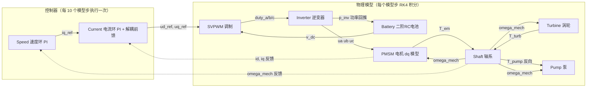

# ATR_C —— 空气涡轮火箭（ATR）电驱系统 C 语言建模与仿真

纯 C11 实现的 ATR（Air Turbo Rocket）电驱动力系统多物理场联合仿真程序：电池（二阶 RC）→ 逆变器（SVPWM）→ PMSM 电机 → 轴系 → 涡轮/泵，速度环/电压环 + 电流环双闭环控制，RK4 定步长积分，多速率调度，结果输出 CSV 供 Python 脚本批量绘图（`plotting/plot.py`，另有 notebook 供交互式探索）。

> 本文档所有文件路径、函数签名、结构体字段与默认值均以当前代码为唯一事实来源逐文件核对。

---

## 目录

- [1. 项目简介](#1-项目简介)
- [2. 快速上手（Quick Start）](#2-快速上手quick-start)
- [3. 目录结构](#3-目录结构)
- [4. 数学原理与公式推导](#4-数学原理与公式推导)
  - [4.1 PMSM dq 模型](#41-pmsm-dq-模型)
  - [4.2 电流环](#42-电流环)
  - [4.3 速度环与电压环](#43-速度环与电压环)
  - [4.4 SVPWM](#44-svpwm)
  - [4.5 逆变器](#45-逆变器)
  - [4.6 轴系](#46-轴系)
  - [4.7 涡轮](#47-涡轮)
  - [4.8 泵](#48-泵)
  - [4.9 电池](#49-电池)
  - [4.10 求解器](#410-求解器)
  - [4.11 无感起动总览与无感化原则](#411-无感起动总览与无感化原则)
  - [4.12 I/F 开环起动与阻尼补偿](#412-if-开环起动与阻尼补偿)
  - [4.13 STSMO 超螺旋滑模观测器](#413-stsmo-超螺旋滑模观测器)
  - [4.14 PLL 位置估计](#414-pll-位置估计)
  - [4.15 起动状态机与无扰切换](#415-起动状态机与无扰切换)
  - [4.16 全包线任务剖面与发电阶段（阶段 3 / SL_STAGE_GEN）](#416-全包线任务剖面与发电阶段阶段-3--sl_stage_gen)
- [5. 代码整体架构](#5-代码整体架构)
- [6. 代码实现介绍（逐模块）](#6-代码实现介绍逐模块)
- [7. 日志系统：如何增删输出列](#7-日志系统如何增删输出列)
- [8. 二次开发指南](#8-二次开发指南)
- [9. 已知限制与注意事项](#9-已知限制与注意事项贡献者须知)

---

## 1. 项目简介

ATR_C 是一个**零第三方依赖**（仅 `-lm` 数学库）的 ATR 电驱系统时域仿真器。它把电气域（电池、逆变器、PMSM）、机械域（轴系）与流体域（涡轮容腔气动、泵液压）耦合成一个 10 维常微分方程组，用四阶 Runge-Kutta（RK4）定步长积分推进，并以数字控制器的真实节拍（模型步长 5e-7 s、控制步长 5e-6 s）做多速率调度。

### 系统框图



能量流：**电池 →（DC 母线）→ 逆变器 →（三相 AC）→ 电机 →（轴功率）→ 泵负载**；涡轮向轴注入机械能。信号流：速度环外环给出 `iq_ref`，电流环内环给出 `ud_ref/uq_ref`，经 SVPWM/逆变器作用到电机。

### 关键特性

- **多速率调度**：模型积分步长 `model_dt = 5e-7 s`，控制器更新周期 `control_dt = 5e-6 s`（每 10 个模型步执行一次控制律），两者必须成整数倍关系（`main.c` 中有运行时校验）。
- **RK4 定步长积分**：10 维状态向量（电流、机械、压力、电池），每步 5 次系统评估（4 个 RK4 子步 + 1 次终态回写评估）。
- **模块化开关**：`SolverSwitches` 可在运行期启停任意组件（逆变器/电机/轴/泵/涡轮/电池），禁用后由 `disabled_*` 常量替代其输出。
- **逆变器双模型**：平均模型（默认）与载波比较开关模型运行期切换（`inverter_params.use_switching_model`）。
- **CSV 日志**：表驱动列定义（`src/Logger.c` 的 `default_columns[]`），表头与数据行自动同步，共 25 列。
- **命令行与参数文件**：仿真时长、步长、目标转速、输出路径等可由命令行覆盖；组件参数可用 `component.field = value` 格式的文本文件覆盖（`--config`）。

---

## 2. 快速上手（Quick Start）

### 依赖

| 依赖 | 要求 | 用途 |
| --- | --- | --- |
| Clang | 支持 C11（建议使用 LLVM 14+） | 编译，`-O3 -march=native` |
| GNU Make | 任意现代版本（≥ 3.81，构建规则使用 `$(eval)` 模板） | 构建 |
| Bear | 可选 | `make compile-commands` 生成 `compile_commands.json` |
| CodeLLDB / LLDB | 可选 | VS Code 中调试 `build/main_debug` |
| Python（numpy/matplotlib） | 可选，仓库 `.venv` 已内置 | `make plot` / `plotting/plot.py` 绘图 |
| Jupyter | 可选 | `plotting/plot.ipynb` 交互式探索 |

### 命令清单

| 命令 | 作用 | 产物 |
| --- | --- | --- |
| `make all` | 发布版编译（`-O3 -march=native`） | `build/main` |
| `make run` | 编译并运行 | `build/main` + `results/simulation.csv` |
| `make debug` | 调试版编译（`-O0 -g3`） | `build/main_debug` |
| `make compile-commands` | 用 Bear 记录 Clang 编译命令 | `compile_commands.json` |
| `make rungdb` | 编译调试版并进入 LLDB | `build/main_debug` |
| `make clean` | 删除整个 `build/` 目录 | — |
| `make rebuild` | `clean` + `all` | `build/main` |
| `make plot` | 运行绘图脚本（优先 `.venv/bin/python`，无 venv 时回退 `python3`） | `results/figures/*.png` |
| `make run-plot` | 一键仿真 + 出图 | `results/simulation.csv` + `results/figures/*.png` |
| `make char` | 编译部件特性工具（稳态特性扫描，见[部件特性数据](#部件特性数据稳态特性扫描)） | `build/char` |
| `make help` | 列出全部目标及说明 | — |

> 注：`make plot` 会先检查 `results/simulation.csv` 是否存在，缺失时提示先执行 `make run`，不会直接报 Python 错误。
>
> 新手入口：仓库根目录的 `./atr.sh` 是上述目标的薄封装（`./atr.sh run`、`./atr.sh char all --plot` 等，见 `./atr.sh help`），命令与 make 目标一一对应，熟悉后可直接用 make。
>
> 构建系统为「单入口 + 模块片段」结构：顶层 `Makefile` 只负责编译选项、规则与任务目标，各模块的源文件清单拆分在 `mk/*.mk`（详见[第 3 章](#3-目录结构)）。新增源文件只需修改对应模块的片段文件。

### Clang / clangd / CodeLLDB

Makefile 默认使用 `clang`，也可以通过变量覆盖编译器：

```sh
make clean all CC=clang
make debug CC=clang
```

安装 Bear 后，在项目根目录执行：

```sh
make compile-commands
```

该命令会重新构建 release 和 debug 目标，并在项目根目录生成
`compile_commands.json`。clangd 会通过根目录的 `.clangd` 自动读取该数据库；
如果 clangd 没有找到它，请确认编辑器打开的是项目根目录，而不是某个子目录。

VS Code 需要安装 **clangd** 和 **CodeLLDB** 扩展。运行 `Make: debug` 后，
在“运行和调试”面板选择“CodeLLDB 调试 main_debug”即可在带 `-g3` 调试符号的
debug 产物上设置断点。Windows 下推荐在 MSYS2 Clang 环境中运行 `make`，
Linux/macOS 则直接使用系统的 `clang`、`make`、`bear` 和 `lldb`。

### 命令行选项（`build/main`）

默认值即 `src/main.c` 中 `SimConfig cfg` 初始化器的硬编码值：

| 选项 | 默认值 | 说明 |
| --- | --- | --- |
| `--duration <s>` | `20.0` | 仿真时长 s |
| `--model-dt <s>` | `5e-7` | 模型积分步长 s |
| `--control-dt <s>` | `5e-6` | 控制器更新周期 s（必须是 model-dt 的整数倍） |
| `--omega-ref-rpm <n>` | `20000` | 目标转速 rpm（内部换算为 rad/s） |
| `--control-mode <m>` | `speed` | 外环模式：`speed` 速度环 / `voltage` 电压环（发电稳压，速度环旁路、无弱磁） |
| `--vref <V>` | `540` | 电压环母线电压参考 V（仅 voltage 模式生效；参数文件 `sim.v_ref` 可覆盖默认值，命令行优先） |
| `--sensorless` | 关 | 启用无感起动（I/F+STSMO+PLL → 速度闭环），替换默认有感起动链；关闭时全路径与有感基线逐字节一致（见 [4.11](#411-无感起动总览与无感化原则)） |
| `--if-current <A>` | `60` | I/F 开环起动电流幅值 A（仅 `--sensorless` 生效；参数文件 `sensorless.if.i_start` 可覆盖，配置优先） |
| `--switch-rpm <n>` | `2000` | I/F→闭环切换转速 rpm 机械角（仅 `--sensorless` 生效；参数文件 `sensorless.if.omega_switch_rpm` 可覆盖，配置优先） |
| `--log-stride <n>` | `1000` | 每隔多少个模型步记录一行 CSV |
| `--output <path>` | `results/simulation.csv` | CSV 输出路径（父目录不存在时自动创建） |
| `--config <path>` | 无 | 组件参数文件（格式见 `include/utils/param_file.h`） |

### 运行产出与绘图

```bash
make run                          # 生成 results/simulation.csv（默认 25 列；--sensorless 时 28 列，见第 7 章）
make plot                         # 批量绘制转速/电流/功率/SOC 等曲线到 results/figures/
```

绘图脚本 `plotting/plot.py` 支持命令行参数（`--csv`、`--outdir`、`--tmax`、`--vref`、`--dpi`、`--show`，详见 `--help`）；图表清单由脚本内 `PLOTS` 声明式定义，新增图表只需追加一项。CSV 含控制链观测列时（电压模式输出）额外绘制发电稳压图集（`gen_v_dc.png` / `gen_iq_tracking.png` / 能力边界主图 `gen_boundary.png`）；CSV 含无感诊断列时（`--sensorless` 输出）额外绘制无感起动图集（转速真值/估计对比 `sensorless_omega.png`、位置误差时程 `sensorless_theta_err.png`、状态机阶梯叠加转速 `sensorless_stage.png`）；CSV 到达发电阶段 3 时（任务剖面）再额外绘制任务剖面四图（`mission_speed_stage.png` / `mission_iq.png` / `mission_v_dc.png` / `mission_theta_err.png`）。各图集缺列（或未达相应阶段）时整组自动跳过。交互式探索可用 `plotting/plot.ipynb`（复用 `plot.py` 中的函数）。

### 发电稳压能力边界测试（voltage 模式）

电压环作为唯一 iq 指令源接入主循环（`iq<0` 发电制动，速度环旁路，`id_ref` 恒 0，无弱磁），涡轮供气斜坡拖动转速上扫，实测发电稳压的能力边界：

```bash
make
./build/main --control-mode voltage --config config/gen_voltage_reg.txt \
    --duration 15 --output results/gen_voltage_reg.csv
python plotting/plot.py --csv results/gen_voltage_reg.csv
```

工况见 `config/gen_voltage_reg.txt`：10 s 内 `turb_m_dot` 由 0.3 线性升至 1.2 kg/s（`turb_T_in = 1000 K`、`turb_p_in = 600 kPa`），电压环 PI 调参与 `sim.v_ref = 540`。反电动势 $E = p\,\omega_m\psi_f$ 达到 SVPWM 线性区上限 $v_{dc}/\sqrt{3}\approx311.8$ V 即理论临界转速 25019 rpm 处，电流环电压矢量饱和（`mod_scale < 1`），电压环丧失电流跟踪能力。仿真结束终端打印三项边界实测：a) `mod_scale` 首次饱和的转速；b) 边界后 $\lvert i_q - i_q^{*}\rvert$ 最大偏差；c) $\lvert v_{dc} - v_{ref}\rvert$ 首次超 2 V 的时刻/转速。实测：临界转速 25018.3 rpm（理论 25019），边界后电流偏差增至 1155 A，$v_{dc}$ 偏离 >2 V 于 26061.7 rpm；能力边界主图 `results/figures/gen_boundary.png` 按时间轴三联展示（mod_scale / iq 跟踪 / v_dc），左列全程、右列边界穿越放大，自动标注调制饱和起点与稳压失效点。

### 无感全包线任务剖面（sensorless + mission）

在无感起动链上扩展第四阶段（发电稳压），覆盖"无感起动 → 速度闭环 20000 rpm → 供气渐增 → 自动切入发电"的全包线任务剖面（推导见 [4.16 节](#416-全包线任务剖面与发电阶段阶段-3--sl_stage_gen)）：

```bash
make
./build/main --sensorless --config config/sensorless_mission.txt \
    --duration 15 --output results/sensorless_mission.csv
python plotting/plot.py --csv results/sensorless_mission.csv
```

工况见 `config/sensorless_mission.txt`：继承 `sensorless_start.txt` 的起动整定与容腔初压（背压，消除起动吹除飞车）；供气延迟斜坡 `boundary.ramp_t_start=3`（起动+加速+整定完成后才供气）、`ramp_time=1`、终值 `turb_m_dot=0.4`；发电切换判据 `sensorless.gen.iq_th=5`/`hold_ticks=400`/`iq_lpf_hz=50`；电压环 `sim.v_ref=540`。仿真结束终端在原有无感起动验收块之后追加"任务剖面摘要"：各阶段切换时刻/转速、交接 $\lvert\Delta i_q^{ref}\rvert$、发电段 $v_{dc}$ 瞬态/稳态偏差、$\max\lvert\theta_{err}\rvert$、min `mod_scale`、平衡转速、末端 $p_{inv}$ 与 SOC 起/切/终三点（仅切入发电时打印，`sensorless_start` 不进阶段 3 故其输出不变）。CSV 到达阶段 3 时 `plot.py` 额外绘制任务剖面四图：全阶段转速+状态机阶梯 `mission_speed_stage.png`、iq/iq_ref 符号穿越 `mission_iq.png`、$v_{dc}$ 稳压 `mission_v_dc.png`、$\theta_{err}$ 全程 `mission_theta_err.png`（缺列或未达阶段 3 自动跳过）。

> **为什么必须 `--sensorless` + `--config config/sensorless_mission.txt` + 足够长的 `--duration` 三者齐备，才能跑出完整任务剖面？** 阶段 0→1→2→3 不是默认行为，而是这三个参数共同「解锁」出来的，缺任一项都只能得到剖面的一段：
>
> - **`--sensorless` 决定有没有阶段机**：四阶段状态机（`SL_STAGE_IF/BLEND/CLOSED/GEN`）只在无感链路里运行（`src/main.c` 的 `if (cfg.sensorless)` 分支）。不带它走的是有感速度环基线，既无 I/F 开环起动也无阶段机，根本谈不上任务剖面。
> - **`--config config/sensorless_mission.txt` 决定能不能进阶段 3（发电）**：阶段 2→3 靠「供气渐增 → 涡轮转矩接管 → 速度环 `iq_ref` 被压到阈值」触发，而这条链在默认参数下是**关闭**的——`model/solver/BoundaryDefaults.c` 中 `turb_m_dot=0`、`ramp_t_start=0`，主循环据此判 `use_ramp_profile=false` 走常量剖面，涡轮全程零转矩；`model/control/sensorless.c` 中 `gen_iq_th=-1e9`，切换判据恒不成立、阶段 3 被显式禁用。该参数文件正是把这些键打开（`ramp_t_start=3` 延迟供气并令 `use_ramp_profile=true`、`turb_m_dot=0.4`、`gen.iq_th=5`/`hold_ticks=400`、`sim.v_ref=540`）。不带它，跑到的就是 `sensorless_start.txt` 那套「起动 + 空载稳速」，永远停在阶段 2。
> - **`--duration` 足够长决定剖面完不完整**：任务剖面时间线本身就长——供气刻意延迟到 `t=3 s` 才起坡、3→4 s 线性升至终值，涡轮转矩抬升把 `iq_ref` 压过阈值后约 `t≈4 s` 切入发电，随后还要整定到发电稳态约 `t≈15 s`。故 `--duration` 必须覆盖整条时间线：`≤3 s` 连供气都没开始、到不了阶段 3；`~10 s` 能进阶段 3 却截断在稳态之前；`≥15 s` 才是完整剖面（配置文件与本文示例取 15）。稳态诊断取末 1 s 窗口（`t ≥ duration−1`），时长不足会把未整定段误当稳态。内置默认时长 20 s 已覆盖该时间线，示例显式写 `--duration 15` 是为与整定值一致、可复现，并提醒不要缩到时间线以下。
>
> 一键复现（写入默认 `results/simulation.csv` 并自动出图，含任务剖面四图）：
>
> ```bash
> make run-plot ARGS="--sensorless --config config/sensorless_mission.txt --duration 15"
> ```

### 部件特性数据（稳态特性扫描）

只跑单个部件的稳态特性（不走全系统仿真）时，用统一入口 `tools/char.py`：

```bash
python tools/char.py turbine                 # 涡轮：压比×转速网格 → results/char_turbine.csv
python tools/char.py all --plot              # 全部部件 + 出图 → results/figures/char/
python tools/char.py pump -n 61 -c 参数文件  # 自定义网格密度与组件参数文件（与 --config 同格式）
python tools/char.py turbine-check           # 涡轮 7 点试验数据校验（误差 >1% 时非零退出）
python tools/char.py turbine-check-dynamic   # 同上，但走完整流路动态积分至稳态（诊断模式）
```

原理：各组件的 `*_evaluate` 均为纯函数，`build/char` 对边界条件网格逐点调用直接得到稳态特性，**不依赖求解器与控制链**，毫秒级完成。当前支持：

| 部件 | 扫描维度 | 主要输出列 |
| --- | --- | --- |
| `turbine` | 膨胀比 π（1.0–4.0，覆盖试验包线）× 转速（2k–60k rpm） | 流量/换算流量/转矩/功率/等熵效率 |
| `pump` | 转速（1k–20k rpm）× 比流量 Q/n（试验包线内满网格） | 扬程/流量/转矩/轴功率/水力功率/效率 + 扬程/效率三维曲面 |
| `battery` | 负载功率（±2 MW，正放电负充电） | 电流/端电压/端口功率/电压口径效率（端口功率/内电源功率，体现欧姆内阻损耗） |
| `battery-dynamic` | 阶跃负载功率（±0.5/±1/±1.5/±2 MW 八档）× 120 s 时间 | 端电压/电流/极化电压阶跃响应族线（R0 瞬时跳变 + RC 极化漂移）+ 三维曲面 |
| `turbine-check` | 固定 7 个真实试验工况点（非扫描，不参与 `all`/`--plot`） | 模型流量/实测流量/误差%/速比 u/c₀/U-C 效率/20000 rpm 功率 |
| `turbine-check-dynamic` | 同上 7 点，但对两容腔动态积分至稳态后比对 | 稳态流量/前腔压力/压力偏差%/速比 u/c₀/U-C 效率/功率/收敛耗时/腔压比 |

`turbine` 的二维扫描在 `--plot` 时除参数族曲线外，还额外输出流量/功率的三维曲面图（`char_turbine_flow_3d.png` / `char_turbine_power_3d.png`，壅塞平台与功率包络更直观）。`pump` 同样额外输出扬程/效率的三维曲面图（`char_pump_head_3d.png` / `char_pump_eff_3d.png`，效率脊线即 $\eta(Q/n)$ 的最优比流量带）；泵扫描按转速 × 比流量 $Q/n$ 满网格覆盖试验包线，$Q$ 在不同转速下不共网格，绘图脚本自动改用按行对齐的结构化曲面。`battery-dynamic` 额外输出端电压/电流/极化电压的三维曲面（`char_battery_dyn_*_3d.png`，即阶跃响应在功率×时间平面上的扇形展开，充电/放电两翼对称）。

`turbine-check` 用当前全局涡轮参数（默认值即试验标定值）逐点复算涡轮试验数据（见 [4.7 节](#47-涡轮)），任一点流量误差超过 1% 时报失败并返回非零，可用作涡轮模型的回归测试。`turbine-check-dynamic` 是其附加诊断模式：不绕开容腔动态，以流量源语义注入试验点实测流量（引气边界，接口参数仅该工具内定义），用全局参数（含试验台标定的自由排气面积 `A_outlet`）对两容腔方程做 RK4 积分至稳态，判定量为稳态前腔压力对试验入口压力的偏差（流量源下稳态通流量恒等于注入流量，模型残差全部体现在前腔压力上；壅塞分支流量正比于前腔压力，压力偏差与代数模式的流量误差互为相反数），偏差 >1% 或未收敛报失败，用于验证完整流路与积分链。

### 改哪儿

不用命令行时，直接改 `src/main.c`：

| 想改什么 | 位置（`src/main.c`） |
| --- | --- |
| 仿真时长 | `SimConfig cfg` 的 `.duration_s = 20.0` |
| 目标转速 | `SimConfig cfg` 的 `.omega_ref_mech = 2094.39510239`（rad/s，即 20000 rpm） |
| d/q 轴电流参考 | 主循环前的 `id_ref_cmd` / `iq_ref_cmd`（闭环运行时每个控制拍会被速度环输出覆盖；`id_ref_cmd` 在控制拍内固定置 0） |
| 电池附加负载功率 | `input_defaults.batt_p_load`（W，正 = 放电） |
| 涡轮/泵气液边界 | `input_defaults` 的 `turb_p_in / turb_p_out / turb_T_in / turb_m_dot / pump_p_suction / pump_p_downstream` |
| 步长与日志间隔 | `SimConfig cfg` 的 `.model_dt / .control_dt / .log_stride` |

---

## 3. 目录结构

```bash
ATR_C
├── include/                  # 全部头文件（对外接口 + 结构体定义）
│   ├── component/            # 物理组件接口：Battery/Inverter/Motor/Pump/Shaft/Turbine.h
│   ├── control/              # 控制器接口：Current/Speed/SVPWM/Voltage.h
│   ├── solver/               # 求解器接口：Solver.h（状态/输入/开关）、RK4.h、BoundaryProfile.h
│   ├── utils/                # 头文件内联工具：numeric_utils.h（限幅）、transforms.h（坐标变换）、param_file.h
│   └── Logger.h              # CSV 日志器接口（表驱动列定义）
├── model/
│   ├── component/            # 物理组件实现：每个 .c = 全局参数 + evaluate（纯计算）+ apply_state（回写）
│   ├── control/              # 控制器实现：PI 电流/速度/电压环、SVPWM 调制
│   └── solver/               # Solver.c（系统装配/step）、RK4.c（积分公式）、BoundaryProfile.c（边界剖面）、BoundaryDefaults.c（边界默认值）
├── src/
│   ├── main.c                # 入口：命令行解析、多速率主循环、控制链装配、进度条
│   ├── Logger.c              # CSV 日志器实现 + 列定义表 default_columns[]
│   └── param_file.c          # 参数文件解析（键名绑定表 bindings[]）
├── plotting/                 # 绘图后处理代码与静态资源（进 git）
│   ├── plot.py               # 结果批量绘图脚本（make plot 调用，支持命令行参数）
│   ├── plot.ipynb            # 交互式探索 notebook（复用 plot.py 中的函数）
│   ├── plot_char.py          # 部件特性曲线绘图（由 tools/char.py --plot 调用）
│   └── fonts/                # 绘图字体（TimesNewRoman / SimSun）
├── tools/                    # 部件特性工具：稳态特性扫描与试验数据校验（见“部件特性数据”）
│   ├── char.py               # 统一入口脚本（自动编译 + 扫描/校验 + 可选出图）
│   ├── char_main.c           # C 入口：CLI 解析与部件调度表（新增部件在此登记）
│   ├── char_<部件>.c         # 各部件特性扫描实现（turbine/pump/battery）
│   ├── char_turbine_check.c  # 涡轮 7 点试验数据校验（build/char turbine-check）
│   └── char_turbine_check_dynamic.c  # 动态稳态校验（build/char turbine-check-dynamic）
├── results/                  # 仿真产出（生成物，.gitignore 整体忽略，可重新生成）
│   ├── simulation.csv        # 仿真输出（make run 生成）
│   ├── char_<部件>.csv       # 部件特性数据（tools/char.py 生成）
│   └── figures/              # 绘图输出（make plot / tools/char.py --plot，特性图在 char/ 子目录）
├── Makefile                  # 构建入口：聚合 mk 片段、编译选项、规则、任务目标（make help 查看全部目标）
├── atr.sh                    # 新手入口：make 目标的薄封装（./atr.sh help，不含编译逻辑）
├── turbine_params.txt        # 涡轮标定参数记录（默认值已内置同一标定，兼作 --config 示例）
├── config/                   # 工况参数文件（--config 加载）
│   └── gen_voltage_reg.txt   # 发电稳压能力边界测试案例（voltage 模式 + 供气斜坡）
├── mk/                       # 模块源文件清单（每模块一个 .mk，由顶层 Makefile include）
│   ├── app.mk                # 应用层：main.c / Logger.c / param_file.c
│   ├── component.mk          # 物理组件：Motor/Battery/Inverter/Shaft/Pump/Turbine
│   ├── control.mk            # 控制器：Current/Speed/SVPWM/Voltage
│   ├── solver.mk             # 求解器：Solver/RK4/BoundaryProfile
│   └── tools.mk              # 特性工具：char_main/char_turbine/char_turbine_check[_dynamic]/char_pump/char_battery
└── build/                    # 编译产物（make clean 可整体删除）
```

---

## 4. 数学原理与公式推导

约定：$\omega_m$ 机械角速度（rad/s），$\omega_e = p\,\omega_m$ 电角速度（rad/s），$p$ 极对数，$\theta_e = p\,\theta_m$ 电角度（rad）。全工程坐标变换统一采用**幅值不变约定**（Clarke 系数 2/3），实现集中在 `include/utils/transforms.h`，组件内禁止手写变换。

### 4.1 PMSM dq 模型

**物理背景**：表贴式永磁同步电机（PMSM，本项目默认 $L_d = L_q$）在转子磁场定向坐标系（dq）下解耦为两个一阶电流动态。

**Clarke 变换**（abc → αβ，幅值不变，`clarke_abc_to_ab()`）：

$$
\begin{aligned}
u_\alpha &= \tfrac{2}{3}\left(u_a - \tfrac{1}{2}u_b - \tfrac{1}{2}u_c\right) \\
u_\beta  &= \tfrac{2}{3}\cdot\tfrac{\sqrt{3}}{2}\,(u_b - u_c)
\end{aligned}
$$

**Park 变换**（αβ → dq）：

$$
\begin{aligned}
u_d &= u_\alpha\cos\theta_e + u_\beta\sin\theta_e \\
u_q &= -u_\alpha\sin\theta_e + u_\beta\cos\theta_e
\end{aligned}
$$

**电压方程（电流状态导数）**：

$$
\begin{aligned}
\frac{di_d}{dt} &= \frac{u_d - R_s i_d + \omega_e L_q i_q}{L_d} \\
\frac{di_q}{dt} &= \frac{u_q - R_s i_q - \omega_e L_d i_d - \omega_e \psi_f}{L_q}
\end{aligned}
$$

其中 $R_s$ 定子电阻（Ω），$L_d, L_q$ 为 dq 轴电感（H），$\psi_f$ 永磁体磁链（Wb）。实现中 $L_d, L_q$ 经 `fmax(·, 1e-9)` 防除零。

**转矩方程**（幅值不变约定下的标准式）：

$$
T_{em} = \frac{3}{2}\,p\,\bigl[\psi_f i_q + (L_d - L_q)\,i_d i_q\bigr]
$$

代码为 `THREE_2 * params->p * (psi_f*iq + (Ld-Lq)*id*iq)`（`model/component/Motor.c` 的 `motor_evaluate_electrical()`），其中 `THREE_2 = 1.5`，与教科书标准式一致。默认参数 $L_d = L_q$，磁阻转矩项恒为 0。

**对应代码**：`motor_evaluate_electrical()`（纯计算）→ `motor_apply_state()`（回写观测量）。

### 4.2 电流环

**结构**：dq 轴各一个 PI + 稳态解耦前馈 + 电压矢量幅值限幅 + 抗饱和（back-calculation）积分器。代码：`model/control/Current.c` 的 `current_evaluate()`。

**误差与 PI 项**（$e_d = i_d^* - i_d$，$e_q = i_q^* - i_q$）：

$$
v_{d,\mathrm{pi}} = k_{p,d}\,e_d + I_d,\qquad
v_{q,\mathrm{pi}} = k_{p,q}\,e_q + I_q
$$

**解耦前馈**（注意：代码使用了含电阻项的完整稳态电压前馈，而非仅交叉耦合项）：

$$
\begin{aligned}
v_{d,\mathrm{ff}} &= R_s i_d - \omega_e L_q i_q \\
v_{q,\mathrm{ff}} &= R_s i_q + \omega_e L_d i_d + \omega_e \psi_f
\end{aligned}
$$

**电压矢量限幅**（保持矢量方向，等比例缩放到 SVPWM 线性区）：

$$
u_{\lim} = \max(|v_{dc}|, 1)\cdot k_{\mathrm{lin}},\qquad
s = \mathrm{clamp}\!\left(\frac{u_{\lim}}{\sqrt{u_d^2 + u_q^2}},\,0,\,1\right),\qquad
u_{d}^{*} = s\,u_d,\quad u_{q}^{*} = s\,u_q
$$

其中 $k_{\mathrm{lin}}$ 即调用方传入的 `linear_limit`（`main.c` 中设为 $1/\sqrt{3}$）。

**抗饱和积分器更新**（离散，采样周期 $T_s$）：

$$
I_{d} \leftarrow I_{d} + \bigl[k_{i,d}\,e_d + k_{aw}\,(u_d^{*} - u_d)\bigr]T_s,\qquad
I_{q} \leftarrow I_{q} + \bigl[k_{i,q}\,e_q + k_{aw}\,(u_q^{*} - u_q)\bigr]T_s
$$

默认 `anti_windup_gain = 0`，即抗饱和回算项实际不生效，退化为普通积分。另外结构体中 `ud_ref_max/min`、`uq_ref_max/min` 四个逐轴限幅字段已定义但**未在实现中使用**（限幅走矢量幅值缩放路径）。

### 4.3 速度环与电压环

**速度环**（`model/control/Speed.c`，`speed_evaluate()`）：PI + 输出限幅 + 抗饱和，输出 q 轴电流参考。

$$
e_\omega = \omega_m^* - \omega_m,\qquad
i_q^{\mathrm{unsat}} = k_p e_\omega + I_\omega,\qquad
i_q^{*} = \mathrm{clamp}\!\left(i_q^{\mathrm{unsat}},\, i_{q,\min},\, i_{q,\max}\right)
$$

$$
I_\omega \leftarrow I_\omega + \bigl[k_i e_\omega + k_{aw}(i_q^{*} - i_q^{\mathrm{unsat}})\bigr]T_s
$$

**电压环**（`model/control/Voltage.c`，`voltage_evaluate()`）：与速度环完全同构的 PI，输出同样是 `iq_ref`。发电（$i_q<0$）把机械功率注入母线、抬升 $v_{dc}$，故稳定方向为 $e_v = v_{meas} - v^*$（$v_{dc}$ 偏低→加大发电抬升，$v_{dc}$ 偏高→减小发电回落；取反号 $v^* - v_{meas}$ 则成正反馈）：

$$
e_v = v_{meas} - v^*,\qquad
i_q^{\mathrm{unsat}} = k_p e_v + I_v,\qquad
i_q^{*} = \mathrm{clamp}\!\left(i_q^{\mathrm{unsat}},\, i_{q,\min},\, i_{q,\max}\right)
$$

$$
I_v \leftarrow I_v + \bigl[k_i e_v + k_{aw}(i_q^{*} - i_q^{\mathrm{unsat}})\bigr]T_s
$$

`--control-mode voltage` 时主循环调用 `voltage_evaluate()` 作为唯一 iq 指令源（速度环旁路，`id_ref` 恒 0，无弱磁），见 [发电稳压能力边界测试](#发电稳压能力边界测试voltage-模式)；默认 `speed` 模式电压环不参与控制。

### 4.4 SVPWM

**实现方式**：等效 SVPWM——先逆 Park/逆 Clarke 得三相正弦参考，再做 min-max 零序注入，效果与七段式 SVPWM 相同。代码：`model/control/SVPWM.c` 的 `svpwm_evaluate()`。

**dq → αβ → abc**（`dq_to_abc()`，幅值不变逆变换）：

$$
\begin{aligned}
u_\alpha &= u_d^{*}\cos\theta_e - u_q^{*}\sin\theta_e,\qquad
u_\beta = u_d^{*}\sin\theta_e + u_q^{*}\cos\theta_e \\
u_a &= u_\alpha,\qquad
u_b = -\tfrac{1}{2}u_\alpha + \tfrac{\sqrt{3}}{2}u_\beta,\qquad
u_c = -\tfrac{1}{2}u_\alpha - \tfrac{\sqrt{3}}{2}u_\beta
\end{aligned}
$$

**min-max 零序注入**（把三相参考对称居中，提高直流电压利用率约 15.5%）：

$$
u_0 = -\frac{\max(u_a,u_b,u_c) + \min(u_a,u_b,u_c)}{2},\qquad
u_x' = u_x + u_0,\quad x\in\{a,b,c\}
$$

**调制度限幅**（线性区上限为相电压幅值 $v_{dc}/\sqrt{3}$）：

$$
s_m = \mathrm{clamp}\!\left(\frac{k_{\mathrm{lin}}\,v_{dc}}{\max\bigl(|u_a'|,|u_b'|,|u_c'|,\,10^{-9}\bigr)},\,0,\,1\right),\qquad
u_x'' = s_m\,u_x'
$$

`linear_limit` 由 `main.c` 设为 `INV_SQRT3`（$1/\sqrt{3} \approx 0.5774$）。

**占空比公式**（相对母线中点，$v_{dc}$ 经 `magnitude_floor(·, 1.0)` 防除零）：

$$
d_x = \mathrm{clamp}\!\left(0.5 + \frac{u_x''}{v_{dc}},\,0,\,1\right),\quad x\in\{a,b,c\}
$$

上/下桥臂门级信号：平均意义下 `gate_u_x = d_x`，`gate_l_x = 1 - d_x`。

### 4.5 逆变器

代码：`model/component/Inverter.c` 的 `inverter_evaluate()`。两条路径**都已实现**，由 `inverter_params.use_switching_model` 运行期切换，**默认 0（平均模型）**。

**平均模型（默认）**：占空比直接映射为一个开关周期内的平均相电压（相对母线中点）：

$$
u_x = \left(d_x - \tfrac{1}{2}\right)v_{dc},\quad x\in\{a,b,c\}
$$

**开关模型**（`use_switching_model = 1`）：占空比与频率为 $f_{sw}$（默认 50 kHz）的 $[0,1]$ 三角载波比较，得到瞬时门级电平，相电压取开关电平：

$$
g_x = \begin{cases}1, & d_x \ge c(t)\\ 0, & d_x < c(t)\end{cases},\qquad
u_x = \left(g_x - \tfrac{1}{2}\right)v_{dc}
$$

其中 $c(t)$ 为 `triangle_carrier(sim_time_s, f_sw)` 生成的三角载波。

**直流侧功率回推**（假设逆变器无损耗）：

$$
p_{ac} = u_a i_a + u_b i_b + u_c i_c,\qquad
i_{inv,dc} = \frac{p_{ac}}{v_{dc}},\qquad
p_{inv} = v_{dc}\, i_{inv,dc}
$$

$p_{inv}$ 作为电池的负载功率（叠加 `batt_p_load`）进入电池模型，实现电气域功率闭环。

### 4.6 轴系

代码：`model/component/Shaft.c` 的 `shaft_evaluate_mechanics()`。电机、涡轮、泵刚性同轴，惯量与黏性摩擦合并：

$$
J_{\Sigma} = J_{motor} + J_{turb} + J_{pump},\qquad
b_{\Sigma} = b_{motor} + b_{turb} + b_{pump}
$$

$$
\frac{d\omega_m}{dt} = \frac{T_{em} + T_{turb} - T_{pump} - b_{\Sigma}\,\omega_m}{J_{\Sigma}},\qquad
\frac{d\theta_m}{dt} = \omega_m
$$

符号约定：$T_{turb} > 0$ 向轴注入机械能，$T_{pump} > 0$ 从轴吸收机械能。

### 4.7 涡轮

代码：`model/component/Turbine.c` 的 `turbine_evaluate()`。模型为「引气注入（可经管路导流）→ 前腔（plenum）→ 喷嘴 → 后腔（downstream）→ 出口」的双容腔气动网络，$\gamma$ 比热比，$R$ 比气体常数（J/(kg·K)），$T_{in}$ 入口总温（K）。

**入口质量流量**（流量源语义）：涡轮由引气驱动，引气过程给定总压 $p_{up}$、总温 $T_{in}$ 与流量上限 $\dot m$。入口不再是"压差开方节流"——前腔压力 $p_{pl}$ 是充放气质量平衡的**结果**而非约束输入：

- `A_duct <= 0`（默认，理想直连）：引气流量全部注入前腔，$\dot m_{in} = \max(\dot m,\,0)$；
- `A_duct > 0`（引气管路导流）：先按孔板公式由 $p_{up}/p_{pl}$ 算管路通流能力 $\dot m_{duct}$（壅塞/亚音速两分支，与喷嘴同式，系数 $C_{d,duct} A_{duct}$），再取

$$
\dot m_{in} = \min\bigl(\max(\dot m,\,0),\ \dot m_{duct}\bigr)
$$

即引气能力不足时实际注入量回落。稳态时（$dp_{pl}/dt = 0$）有 $\dot m_{in} = \dot m_{turb}$，通过涡轮的流量由引气流量决定，前腔压力由喷嘴通流特性反推。

**喷嘴流量（壅塞/亚音速两分支）**：令压比 $r = p_{dn}/p_{pl} \in [0,1]$，临界压比

$$
r_c = \left(\frac{2}{\gamma+1}\right)^{\frac{\gamma}{\gamma-1}}
$$

分支判据用壅塞压比上限 $r_{choke}$：`r_choke_nozzle <= 0` 时取经典临界压比 $r_c$；对收扩（超声速）喷嘴，喉部在高于 $r_c$ 的整级压比下仍保持壅塞，可通过 `turbine.r_choke_nozzle` 上调（真实涡轮标定取 0.7，已作为编译期默认值）。

- 壅塞（$r \le r_{choke}$）：

$$
\dot m_{turb} = C_d A\, p_{pl}\,\sqrt{\frac{\gamma}{R\,T_{in}}}\left(\frac{2}{\gamma+1}\right)^{\frac{\gamma+1}{2(\gamma-1)}}
$$

- 亚音速（$r > r_{choke}$）：

$$
\dot m_{turb} = C_d A\, p_{pl}\,\sqrt{\frac{2\gamma}{R\,T_{in}(\gamma-1)}\left(r^{2/\gamma} - r^{(\gamma+1)/\gamma}\right)}
$$

后腔出口流量 $\dot m_{out}$ 用同一组公式（系数 $C_{d,out}, A_{out}$，压比 $p_{back}/p_{dn}$，分支判据恒用经典 $r_c$）；若 $p_{dn} \le p_{back}$ 则 $\dot m_{out} = 0$（不建模倒流）。

**容腔压力动态**（等温充放气）：

$$
\frac{dp_{pl}}{dt} = \frac{R\,T_{in}}{V_{pl}}\left(\dot m_{in} - \dot m_{turb}\right),\qquad
\frac{dp_{dn}}{dt} = \frac{R\,T_{in}}{V_{dn}}\left(\dot m_{turb} - \dot m_{out}\right)
$$

**等熵温降与 U/C 效率 → 功率 → 转矩**（若 $p_{pl} \le p_{dn}$ 则 $T_{turb} = 0$）：

$$
c_p = \frac{\gamma R}{\gamma - 1},\qquad
T_{out}^{ideal} = T_{in}\left(\frac{p_{dn}}{p_{pl}}\right)^{\frac{\gamma-1}{\gamma}},\qquad
\Delta T_{ideal} = \max\bigl(T_{in} - T_{out}^{ideal},\,0\bigr)
$$

等熵效率 $\eta_{isen}$ 采用**速比（U/C）特性**（`mean_radius > 0` 时生效，否则回退常数 `eta_turb`）。推导：单位质量工质的等熵可用焓降 $\Delta h_s = c_p\,\Delta T_{ideal}$ 若全部转化为动能，得到**等熵喷射速度**（spouting velocity）

$$
c_0 = \sqrt{2\,\Delta h_s} = \sqrt{2\,c_p\,T_{in}\left[1 - \left(\frac{p_{dn}}{p_{pl}}\right)^{\frac{\gamma-1}{\gamma}}\right]}
$$

轮周速度 $u = |\omega_m|\, r_{mean}$（$r_{mean}$ 为涡轮中径半径）。冲动式涡轮的级效率是速比 $x = u/c_0$ 的近似抛物线函数（动量交换在 $u \approx c_0/2$ 附近最优，实际因余速/叶型损失峰值左移），用试验标定的二次多项式拟合并夹取到 $[0,1]$：

$$
\eta_{isen}(x) = \mathrm{clamp}\bigl(a\,x^2 + b\,x + c,\ 0,\ 1\bigr),\qquad
x = \frac{u}{c_0}
$$

真实涡轮标定系数 $a=-3.266,\ b=2.469,\ c=0.051$，峰值位于 $x^* = -b/(2a) \approx 0.378$，$\eta_{isen}^{max} \approx 0.518$，符合冲动式涡轮最优速比 0.35–0.45 的典型范围。

**功率与转矩**（$\eta_{mech}$ 机械效率）：

$$
P_{turb} = \dot m_{turb}\, c_p\, \Delta T_{ideal}\, \eta_{isen},\qquad
T_{turb} = \eta_{mech}\,\frac{P_{turb}}{\max(|\omega_m|,\,\omega_{floor})}
$$

**真实涡轮标定**（7 个试验工况点，见根目录 `turbine_params.txt` 与 `参数.md`）：固定 $\gamma=1.18$、$R=380$、$A=0.00246\ \mathrm{m^2}$、$C_d=1.0$、$r_{choke}=0.7$ 时，7 点流量误差均 $<0.8\%$（逐点真实物性下 $<0.2\%$，反算 $C_d \approx 1.001$）。**上述标定值已直接作为 `Turbine.c` 的编译期默认参数**，`make run` / `build/char` 不带 `--config` 即为标定涡轮；`turbine_params.txt` 保留作为标定值的显式记录与 `--config` 格式示例。校验命令：`make char && ./build/char turbine-check`（任一点流量误差 $>1\%$ 时返回非零）。

### 4.8 泵

代码：`model/component/Pump.c` 的 `pump_evaluate()`。试验拟合特性（扬程 + 效率）+ 出口容腔弹性压力动态。

**试验拟合特性**（`参数.md`，$H$ 单位 m，$Q$ 单位 L/s，$n$ 单位 r/min）：

$$
H = h_{qq} Q^2 + h_{qn} Q n + h_{nn} n^2,\qquad
\eta = e_{x3}\left(\tfrac{Q}{n}\right)^3 + e_{x2}\left(\tfrac{Q}{n}\right)^2 + e_{x1}\tfrac{Q}{n} + e_{x0}
$$

默认参数即拟合系数。每拍由系统扬程 $H_{sys} = \max(p_{dis} - p_{suc},\,0)/(\rho g)$ 反解 $H(Q,n)=H_{sys}$ 的二次方程，取**下降支根**（$H$ 随 $Q$ 递减的泵稳定工作支）得运行流量；判别式为负（系统扬程超出曲线能力）或根非正时无工况点。效率拟合须为正（试验包线内），否则同样视为无有效工况点；两种情况均 $Q_{pump}=0$、$T_{pump}=0$，此时 $H$ 报关死扬程 $h_{nn} n^2$ 作能力指示。

**容腔弹性压力动态**（$\beta_{eff}$ 有效体积弹性模量 Pa，$V_{out}$ 出口容积 m³，$R_{out}$ 下游流阻）：

$$
Q_{out} = \max\!\left[\frac{p_{dis} - p_{dn}}{R_{out}},\,0\right],\qquad
\frac{dp_{dis}}{dt} = \frac{\beta_{eff}}{V_{out}}\left(Q_{pump} - Q_{out}\right)
$$

**功率 → 转矩**（$g = 9.80665\ \mathrm{m/s^2}$）：

$$
P_{hyd} = \rho g Q_{pump} H,\qquad
P_{shaft} = \frac{P_{hyd}}{\eta},\qquad
T_{pump} = \frac{P_{shaft}}{\max(|\omega_m|,\,10^{-6})}\cdot\underbrace{\frac{|\omega_m|}{|\omega_m| + \omega_{knee}}}_{\text{低速平滑因子}}
$$

低速平滑因子（$\omega_{knee} = \max(\omega_{floor}, 1)$）使 $T_{pump}$ 在 $\omega_m \to 0$ 时连续过零，避免 $P/\omega$ 在零速处的奇异。注意效率拟合在包线边界 $\eta \to 0^+$ 时轴功率发散（拟合多项式的自然形态），模型不应运行于试验包线之外。

### 4.9 电池

代码：`model/component/Battery.c`。二阶 RC 等效电路（Thevenin 模型）：开路电压 $V_{oc}$（**常数 540 V，未做 SOC 查表**）串联欧姆内阻 $R_0$ 与两个 RC 极化支路 $(R_1,C_1), (R_2,C_2)$。符号约定：$i > 0$ 放电。

动态响应特性由 `battery-dynamic` 生成：固定 SOC、极化电压零起，施加阶跃负载功率并对极化状态 RK4 积分（$\tau_1 = R_1 C_1 = 7.2$ s、$\tau_2 = R_2 C_2 = 32$ s），输出端电压/电流/极化电压的阶跃响应族线；SOC 库仑积分属更慢时间尺度，测试中保持恒定。

**端口方程**：

$$
V_{th} = V_{oc} - v_{rc1} - v_{rc2},\qquad
v_{batt} = V_{th} - i\,R_0
$$

**由功率约束解电流**（`battery_evaluate_from_state()`）。端口功率 $P = v_{batt}\, i$ 给出一元二次方程：

$$
R_0\, i^2 - V_{th}\, i + P = 0
$$

判别式与可行功率上限：

$$
\Delta = V_{th}^2 - 4 R_0 P,\qquad
P_{\max} = \frac{V_{th}^2}{4 R_0}
$$

实现先取 $P_{req} = \min(P, P_{\max})$（保证 $\Delta \ge 0$，再经 `fmax(·,0)` 兜底），然后**取小根**：

$$
i = \frac{V_{th} - \sqrt{\Delta}}{2 R_0}
$$

放电（$P>0$）时小根对应物理上稳定的低电流高电压工作点；充电（$P<0$）时 $\Delta > V_{th}^2$，该根自动为负，无需分支。端电压再经 `fmax(·, 0)` 保护。

**RC 支路与 SOC 状态导数**（`battery_evaluate_deriv_from_state()`，$Q = 3600\,C_{Ah}$ 为容量（库仑），$\eta$ 库伦效率）：

$$
\frac{dv_{rc1}}{dt} = -\frac{v_{rc1}}{R_1 C_1} + \frac{i}{C_1},\qquad
\frac{dv_{rc2}}{dt} = -\frac{v_{rc2}}{R_2 C_2} + \frac{i}{C_2},\qquad
\frac{d\,SOC}{dt} = -\frac{\eta\, i}{Q}
$$

### 4.10 求解器

代码：`model/solver/Solver.c`（系统装配）、`model/solver/RK4.c`（积分公式）。

**10 维状态向量**（`SystemState`，`include/solver/Solver.h`）：

$$
\mathbf{x} = \bigl[\,i_d,\ i_q,\ \theta_m,\ \omega_m,\ p_{dis},\ p_{pl},\ p_{dn},\ SOC,\ v_{rc1},\ v_{rc2}\,\bigr]^{\mathsf T}
$$

**RK4 四阶公式**（`step()` 调用 `add_scaled()`/`combine_rk4()`，$h$ = `model_dt`）：

$$
\begin{aligned}
\mathbf{k}_1 &= \mathbf{f}(\mathbf{x}_k,\,t_k) \\
\mathbf{k}_2 &= \mathbf{f}\!\left(\mathbf{x}_k + \tfrac{h}{2}\mathbf{k}_1,\ t_k + \tfrac{h}{2}\right) \\
\mathbf{k}_3 &= \mathbf{f}\!\left(\mathbf{x}_k + \tfrac{h}{2}\mathbf{k}_2,\ t_k + \tfrac{h}{2}\right) \\
\mathbf{k}_4 &= \mathbf{f}\!\left(\mathbf{x}_k + h\,\mathbf{k}_3,\ t_k + h\right) \\
\mathbf{x}_{k+1} &= \mathbf{x}_k + \frac{h}{6}\left(\mathbf{k}_1 + 2\mathbf{k}_2 + 2\mathbf{k}_3 + \mathbf{k}_4\right)
\end{aligned}
$$

积分后 SOC 立即被 `clamp_range(·, 0, 1)` 限制在物理范围内。

**每步 5 次评估的原因**：4 次子步评估（$\mathbf{k}_1 \sim \mathbf{k}_4$）用于积分；第 5 次用**积分后的新状态** $\mathbf{x}_{k+1}$ 重新评估一次（`efinal`），保证回写到各组件 View 的代数观测量（转矩、三相电流、母线电压、功率等）与终态严格一致，而不是子步的中间值。

**可选耦合变量松弛迭代**（`enable_stage_iteration`，默认 0 关闭）：系统存在代数环——$v_{dc}$ 经 SVPWM 线性区上限决定电机相电压，进而决定 dq 电流、转矩与 $\omega_m$；逆变器交流侧功率又回推直流侧电流，经电池内阻决定端电压 $v_{dc}$，形成 $v_{dc}\to$ 电压/电流 $\to p_{inv}\to v_{dc}$ 的闭合依赖；容腔压力与通流量亦互相牵制。单次评估无法令环内各量同时自洽，只能对耦合量取近似值：其中**仅 $v_{dc}$ 取上一步末回写的 `battery_view.v_batt`（一步滞后）**，$\omega_m$、$p_{dis}$、$p_{pl}$、$p_{dn}$ 则取当前 RK4 子步的 `state` 值。

开启迭代后，对耦合量 $\mathbf{z} = [v_{dc}, \omega_m, p_{dis}, p_{pl}, p_{dn}]$ 按带松弛因子的固定点格式收敛：

$$
\mathbf{z}^{(k+1)} = \mathbf{z}^{(k)} + \lambda\left[\mathbf{g}(\mathbf{z}^{(k)}) - \mathbf{z}^{(k)}\right],\qquad \lambda = 0.6
$$

目标值 $\mathbf{g}(\mathbf{z})$ 的**基准为固定的子步 `state`、导数随当前 $\mathbf{z}$ 变化**：$v_{dc}$ 分量取电池评估电压，其余分量取一步显式 Euler 预测 $\text{state} + h\,\dot x$（$h$ 恒为整个模型步长，即使在 $h/2$ 子步内亦然）。收敛判据以**阻尼后的增量** $|\Delta\mathbf{z}| = \lambda\,\lvert\mathbf{g}-\mathbf{z}\rvert$（比真实残差小 $\lambda$ 倍）衡量，三项全部满足即退出，上限 80 次：

$$
|\Delta v_{dc}| < 10^{-2},\qquad
|\Delta \omega_m| < 10^{-4}\ \mathrm{rad/s},\qquad
\max\bigl(|\Delta p_{dis}|, |\Delta p_{pl}|, |\Delta p_{dn}|\bigr) < 10^{-2}\ \mathrm{Pa}
$$

其中 $v_{dc}$ 阈值复用了名为 `STAGE_ITER_EPS_PRESS` 的常量（值 $10^{-2}$ 正确，仅命名对电压不够贴切）。无论收敛还是达到上限，循环结束后都会以最终 $\mathbf{z}$ **再做一次** `evaluate_stage_algebraic_once`，使返回的代数量与收敛值一致；又因 `evaluate()` 在每个 `step` 内被调用 5 次（$\mathbf{k}_1\sim\mathbf{k}_4$ + `efinal`），开启迭代后最坏单步需 $5\times80$ 次组件链评估，这是其显著变慢的原因。

常量定义在 `Solver.c` 顶部：`STAGE_ITER_MAX = 80`、`STAGE_ITER_RELAX = 0.6`、`STAGE_ITER_EPS_OMEGA = 1e-4`、`STAGE_ITER_EPS_PRESS = 1e-2`。

### 4.11 无感起动总览与无感化原则

代码：`model/control/IFStart.c`（I/F 开环）、`STSMO.c`（超螺旋观测器）、`PLL.c`（锁相环）、`sensorless.c`（起动状态机），头文件在 `include/control/`；由 `--sensorless` 启用。默认关闭时主循环走原有感链（`speed_evaluate(真值 ω_m)` → `current_evaluate(真值 id/iq)`），两路径在 `main.c` 控制拍内二选一，关闭路径与改动前逐字节一致。

**无感化总原则（防"假无感"）**：控制侧只允许使用三类信息——

1. 实测三相电流 $i_a,i_b,i_c$（`motor_view`，视为电流传感器测量），经 `clarke_abc_to_ab` 得 $i_{\alpha\beta}$；
2. 控制侧自身发出的电压指令 $u_d,u_q$ 与自身估计角 $\hat\theta$（经 `dq_to_abc` 合成 $u_{\alpha\beta}$ 指令，作为观测器的零阶保持输入）；
3. 母线电压 $v_{dc}$（供电流环前馈/限幅）。

严禁控制侧读取 $\theta_{mech}$、$\omega_{mech}$、`motor_view.id/iq/theta_e/omega_e` 等任何真值。真值仅出现在被控对象内部（Solver/Motor 物理侧不变）与日志诊断列 `theta_err_rad = wrap(θ̂ − p·θ_mech)`（只读、不回馈控制）。

**信号链**：

$$
i_{abc}\ \xrightarrow{\ \text{Clarke}\ }\ i_{\alpha\beta}\ \xrightarrow{\ \text{STSMO}\ }\ \hat e_{\alpha\beta}\ \xrightarrow{\ \text{PLL}\ }\ \hat\theta_e,\ \hat\omega_e
$$

状态机按阶段选择换相角 $\theta_{ctrl}$（$\theta_{if}$ / 插值 / $\hat\theta_e$）与 $i_d,i_q$ 指令；电流环在 $\theta_{ctrl}$ 系闭合（测量电流经正向 Park `park_ab_to_dq(θ_ctrl)`）；$\theta_{ctrl}$ 经 `SystemInput.use_ctrl_theta / theta_ctrl_e` 注入 SVPWM，使逆 Park 使用控制角而非真值角（数字控制一拍一更新的真实语义）。

### 4.12 I/F 开环起动与阻尼补偿

**强制角**：机械角速度斜坡后保持，$\omega_{if}(t)=\min(r\,t,\ \omega_{switch})$，$r=\omega_{switch}/t_{ramp}$；电角 $\omega_{if,e}=p\,\omega_{if}$；无阻尼基准角 $\theta_{ramp}=\int \omega_{if}\,dt$。

**功角与转矩**：I/F 阶段电流矢量落在强制 q 轴（αβ 角 $\theta_{if}+90^\circ$），转子磁链在 $\theta_{true}$，故

$$
T_{em}=K\cos\delta,\qquad K=\tfrac{3}{2}\,p\,\psi_f\,I_f,\qquad \delta=\theta_{if}-\theta_{true}
$$

空载稳态永磁转子如罗盘针趋于对齐定子场：$\theta_{true}\to\theta_{if}+90^\circ$，即 $\delta_0\approx-90^\circ$（转子**超前**强制角约 90°）；升速斜坡末端需少量转矩克服摩擦+惯量，$\delta_0\approx-85^\circ$。定义经典负载角 $\delta'=\delta+90^\circ$（空载平衡 $\delta'_0=0$，失步 $|\delta'|=90^\circ$）。

**线性化振荡模**：对 $\delta'$ 小扰动线性化转子摆动方程，得二阶系统（电角口径）

$$
\omega_n=\sqrt{\frac{p\,K}{J}},\qquad \zeta_{nat}=\frac{b}{2\sqrt{J\,p\,K}}
$$

$I_f=60$ A 时 $K=10.71$ N·m、$\omega_n\approx166$ rad/s（26.5 Hz）、$\zeta_{nat}\approx0.019$——几乎无阻尼，功角会长时间振荡甚至失步，必须补偿。

**阻尼补偿（角度修正）**：用可测电气量构造对功角振荡的阻尼。取 PLL 估计电角速度 $\hat\omega_e$（一阶低通 `damp_lpf_hz` 后）与强制电角速度之差修正强制角：

$$
\theta_{if}=\theta_{ramp}-k_{damp}\cdot g(\omega_{if})\cdot\bigl(\hat\omega_{e,filt}-\omega_{if,e}\bigr)
$$

门控 $g$ 在低速（反电动势小、$\hat\omega_e$ 不可信）时为 0、随 $\omega_{if}$ 线性升到 1（`IF_DAMP_GATE_ON_FRAC/IF_DAMP_GATE_FRAC`），避免 standstill 段把 PLL 噪声注入 $\theta_{if}$。物理依据：$\hat\omega_e-\omega_{if,e}\propto\dot{\delta'}$（估计转速偏离强制转速即功角正在摆动），故该项等效在振荡方程中追加阻尼转矩 $\propto k_{damp}\,p\,K|\sin\delta_0|\,\dot{\delta'}$，使

$$
\zeta\ \to\ \zeta_{nat}+\frac{k_{damp}}{2}\,\omega_n
$$

而 $\omega_n$ 不变。取 $k_{damp}=3.5\times10^{-3}$ s → $\zeta\approx0.31$（良阻尼，抑制功角振荡而不改自然频率）。**为何选角度修正而非速度修正**：若改为修正 $\omega_{if}$（速度通道），该项会进入刚度项而非阻尼项，反而降低 $\zeta$；角度通道只加阻尼、不改自然频率。

**I/F 阶段电流指令**：$i_d^{ref}=0$、$i_q^{ref}=I_f$（常数，参数化），复用 `current_evaluate` 在强制角系闭环（测量电流经 `park_ab_to_dq(θ_if)`，前馈用 $\omega_{if,e}$）。

### 4.13 STSMO 超螺旋滑模观测器

αβ 静止系、按 `control_dt` 前向欧拉离散（表贴式假设 $L_d\approx L_q=L$）。**电流观测**：

$$
\frac{d\hat i_{\alpha\beta}}{dt}=\frac{u_{\alpha\beta}-R_s\,\hat i_{\alpha\beta}-z_{\alpha\beta}}{L}
$$

**超螺旋切换项**（$e=\hat i-i$，β 轴同构）：

$$
z_\alpha=k_1\,|e_\alpha|^{1/2}\,\operatorname{sign}(e_\alpha)+v_\alpha,\qquad \frac{dv_\alpha}{dt}=k_2\,\operatorname{sign}(e_\alpha)
$$

收敛后 $\hat i\to i$、$e\to0$，超螺旋项 $z_{\alpha\beta}$ 连续且 $\approx$ 反电动势 $e_{\alpha\beta}$；再经一阶低通（精确 ZOH 离散 $a=1-e^{-\omega_c T_s}$，截止 `emf_lpf_hz`）抑制切换抖振后送 PLL。

**整定依据**：$k_2$ 须大于反电动势最大变化率 $|de/dt|_{max}\approx E_{max}\,\omega_{e,max}$（20000 rpm 时 $E=\omega_e\psi_f\approx249$ V、$\omega_e\approx4189$ rad/s → 约 $1\times10^6$ V/s），取 $k_2=3\times10^6$ 留裕度；$k_1$ 决定离散滑模到达速度与电流误差抖振带（稳态抖振带 $\sim(k_1T_s/L)^2$，$k_1=5$ 时约 0.5 A，远小于工作电流）；`emf_lpf_hz`=2 kHz（高于 20000 rpm 反电动势基波 666 Hz 约 3×，相位滞后由 PLL 补偿，同时衰减 ~15 kHz 量级切换纹波）。

### 4.14 PLL 位置估计

反电动势矢量指向 q 轴：$(e_\alpha,e_\beta)=E(-\sin\theta_e,\ \cos\theta_e)$。先旋转 $-90^\circ$ 对齐转子 d 轴基准 $r=(e_\beta,\ -e_\alpha)=E(\cos\theta_e,\ \sin\theta_e)$，再幅值归一化 $\hat e=r/\lVert r\rVert$，使鉴相误差与 $E=\omega_e\psi_f$ 幅值无关（**消除 PLL 增益随转速变化**）。

**鉴相误差**：

$$
\varepsilon=\hat e_\beta\cos\hat\theta-\hat e_\alpha\sin\hat\theta=\sin(\theta_e-\hat\theta)
$$

**PI → 估计电角速度**（积分项与总输出均限幅 $\pm\omega_{e,max}$，防未收敛时发散）：

$$
\hat\omega_e=k_p\,\varepsilon+k_i\!\int\varepsilon\,dt
$$

**积分得估计角并回绕** $[0,2\pi)$：$\hat\theta_e=\operatorname{wrap}_{2\pi}\!\bigl(\hat\theta_e+\hat\omega_e\,T_s\bigr)$。归一化后为二阶环：$\omega_n=\sqrt{k_i}$、$\zeta=k_p/(2\sqrt{k_i})$；取 $k_i=5\times10^6\to\omega_n\approx2236$ rad/s（带宽 ~356 Hz）、$k_p=3000\to\zeta\approx0.67$（接近临界阻尼）。

**输出**：机械角速度 $\hat\omega_m=\hat\omega_e/p$ 供速度环；输出转速另经一阶低通（`omega_lpf_hz`=120 Hz）抑制超螺旋纹波（内部角跟踪仍用原始 $\hat\omega_e$，不受滞后影响）；并对反电动势低通的相位滞后做补偿 $\hat\theta_{out}=\hat\theta_e+\arctan(\hat\omega_e/\omega_c)$，否则稳态 `theta_err` 随转速升高而增大。

### 4.15 起动状态机与无扰切换

三阶段（`SensorlessStage`）：0=I/F、1=切换过渡、2=闭环。

**切换判据（0→1，须同时满足且连续 `switch_lock_ticks` 拍）**：

- 强制斜坡到顶：$\omega_{if}\ge\omega_{switch}$（默认 2000 rpm 机械角 ≈10% 额定，此处 $E\approx24.9$ V 信噪比可接受）；
- PLL 锁定：$|\hat\omega_e-\omega_{if,e}|<\texttt{switch\_omega\_tol}$ 且 $|\varepsilon|<\sin(\texttt{switch\_angle\_tol})$。

低速反电动势小、超螺旋纹波使瞬时判据抖动，故先按 `lock_lpf_hz` 低通 $|\varepsilon|$、$|\hat\omega_e-\omega_{if,e}|$ 再比较（判据反映**平均锁定质量**）。注意空载 I/F 稳态 $|\hat\theta-\theta_{if}|\approx85^\circ$ 并非小量，故角度判据用 PLL 相位误差 $\varepsilon$（等价 $|\hat\theta-\theta_{true}|$ 小）而非 $|\hat\theta-\theta_{if}|$。

**切换过渡（阶段 1）**：交换的是【换相角来源】$\theta_{if}\to\hat\theta$，而非把电流硬转到 q 轴；全程【物理电流矢量冻结】在 $\theta_{if}+90^\circ$（转矩≈摩擦，转速平稳）。取最短角差 $\Delta=\operatorname{wrap}_\pi(\hat\theta-\theta_{if})$、进度 $s=t/T_{blend}\in[0,1]$：

$$
\theta_{ctrl}=\theta_{if}+s\,\Delta,\qquad i_d^{ref}=I_f\sin(s\Delta),\qquad i_q^{ref}=I_f\cos(s\Delta)
$$

则物理电流矢量角 $=\theta_{ctrl}+\operatorname{atan2}(i_q^{ref},\,i_d^{ref})=\theta_{if}+s\Delta+(90^\circ-s\Delta)=\theta_{if}+90^\circ$ 恒定（与 $s$、$\Delta$ 符号无关），避免转矩冲击。

**无扰切换（1→2，bumpless）**：$s=1$ 时 $\theta_{ctrl}=\hat\theta$，测得 $i_d\approx I_f\cos\Delta$、$i_q\approx I_f\sin\Delta$（小）；将速度环积分器预置 `speed.int_omega = i_q^{ref}`，使 $i_q^{ref}$ 无跳变交接给速度环 PI 输出；同时阶段 2 转速参考以【当前 $\hat\omega_m$】为起点、`accel_time` 内斜坡升到目标（若沿用阶跃参考，速度环比例项会在交接瞬间把 $i_q$ 顶到数百安）。

**阶段 2**：速度环用 $\hat\omega_m$ 反馈（`speed_evaluate(ref_ω, ω̂_m)`）→ $i_q^{ref}$；电流环在 $\hat\theta$ 系闭合（测量经 `park_ab_to_dq(θ̂)`、前馈 $\hat\omega_e$）；$\hat\theta$ 经 `use_ctrl_theta` 通道注入 SVPWM。

### 4.16 全包线任务剖面与发电阶段（阶段 3 / SL_STAGE_GEN）

在 4.15 的起动三阶段之上扩展第四阶段，构成"无感起动 → 速度闭环 → 供气渐增 → 自动切入发电稳压"的全包线任务剖面（`config/sensorless_mission.txt`，`--sensorless` 运行）。STSMO/PLL/电流环/$\hat\theta$ 注入 SVPWM 在阶段 3 原样续用，$i_d^{ref}=0$（无弱磁），仅【$i_q^{ref}$ 的来源】由速度环换为电压环。

**剖面时间线**（实测，`turb_m_dot=0.4`、`ramp_t_start=3`、`duration=15`）：

| 时刻 (s) | 事件 | 转速 (rpm) |
|---|---|---|
| 0 | I/F 开环起动（阶段 0），容腔初压=背压（无吹除飞车） | 0 |
| 0.301 | PLL 锁定 → 过渡（阶段 1） | 2002 |
| 0.331 | 进入速度闭环（阶段 2），参考斜坡升 20000 rpm | 1998 |
| 3.0 | 供气延迟斜坡启动（`ramp_t_start`，此前 `turb_m_dot=0`） | ~20000 |
| 3.993 | 低通 $i_q^{ref}\le$ 阈值 → 切入发电（阶段 3） | 22326 |
| →15 | 发电稳态：$v_{dc}\to v_{ref}$、$p_{inv}<0$ 回馈、SOC 上升、转速平衡 | ~22000 |

**供气延迟斜坡（阶段 2→3 的物理驱动）**：`boundary_profile_m_dot_ramp` 在 $t<\texttt{ramp\_t\_start}$ 时输出 `turb_m_dot=0`（起动段完全无供气），自 `ramp_t_start` 起 `ramp_time` 内线性升至 `boundary.turb_m_dot` 并保持。供气渐增使涡轮驱动转矩抬升，速度环为守转速把 $i_q^{ref}$ 渐降（可下穿 0 进入回馈）——这正是"电机扭矩需求消失"的信号。

**切换判据（2→3，仅用允许信号，须连续 `gen.hold_ticks` 拍）**：

- 处于阶段 2 且参考斜坡已到顶：$\omega_{ref,m}=\omega_{ref}$（`ref_omega_m == omega_ref_mech`）；
- 低通后的 $i_q^{ref}\le\texttt{gen.iq\_th}$（默认 +5 A，即电机扭矩需求基本消失）。

低通为一阶 $\alpha=1-e^{-2\pi f_c T_s}$、$f_c=\texttt{gen.iq\_lpf\_hz}$（默认 50 Hz）：供气爬坡期速度环的瞬时 $i_q^{ref}$ 带开关纹波，直接用瞬时值会误触发，故判据取低通量（反映**平均扭矩需求**）。`hold_ticks`（默认 400 拍 = 2 ms）再去抖一次。默认 `gen.iq_th=-1e9` 使判据永假（既有 `sensorless_start.txt` 不进阶段 3，回归不变）。

**无扰交接（2→3，bumpless）**：切换瞬间把电压环积分器预置为

$$
\texttt{voltage.int\_v}=i_q^{ref}\big|_{now}-k_p\,(v_{dc}-v_{ref})
$$

使下一拍电压环 PI 输出 $i_q^{ref}=k_p e_v+\texttt{int\_v}$ 恰等于切换前的速度环输出，$i_q^{ref}$ 连续无跳变（实测 $|\Delta i_q^{ref}|=0.000$ A，判据 <10 A）。此式与 4.15 的 1→2 交接同构（预置积分器抵消比例项）。

**阶段 3 每拍**：$i_q^{ref}=\texttt{voltage\_evaluate}(v_{ref},\,v_{dc}).i_q^{ref}$，符号 $e_v=v_{meas}-v_{ref}$（发电 $i_q<0$ 注入母线抬升 $v_{dc}$，唯一稳定方向）；转速解除钳制，平衡点由转矩平衡决定。

**平衡转速分析**：阶段 3 轴系 $J\dot\omega=T_{turb}(\dot m,\omega)+T_{em}(i_q)-T_{fric}(\omega)-T_{pump}(\omega)$，稳态 $\dot\omega=0$ 即 $T_{turb}=|T_{em}|+T_{fric}+T_{pump}$，其中制动转矩 $|T_{em}|=0.1785\,|i_q|$ 由电压环为守 $v_{dc}=v_{ref}$ 而设定。可控性受 SVPWM 线性区约束：驱动 $i_q$ 所需电压裕度

$$
\text{headroom}(\omega)=\frac{v_{dc}}{\sqrt3}-p\,\omega\,\psi_f
$$

须为正（否则 `mod_scale<1`、电流环失跟、制动转矩饱和）。headroom$=0$ 即理论临界 25019 rpm；越过它制动转矩不再随 $i_q^{ref}$ 增长，转速飞车。故平衡转速必须留在临界以下，整定目标 <24500 rpm 留裕度。实测 `turb_m_dot=0.4` 平衡 ~22000 rpm：$E=0.01246\times22000\approx274$ V，headroom $\approx311.8-274=38$ V，远大于驱动 $|i_q|\approx5$ A 所需（$\sim1$ V），故 `mod_scale` 全程 =1。

**平衡转速整定记录**（`duration=15 s`，扫描 `boundary.turb_m_dot`）：

| turb_m_dot (kg/s) | 阶段 | 切换 t (s) | 峰值 (rpm) | 平衡 (rpm) | min mod_scale | 结论 |
|---|---|---|---|---|---|---|
| 0.3 | 0,1,2 | 不触发 | 21344 | 20000 | 1.0000 | 供气不足：守 20000 rpm 仍需正 $i_q$，$i_q^{ref}$ 不下穿阈值 |
| **0.4** | **0,1,2,3** | **3.993** | **23276** | **22025** | **1.0000** | **选定：全包线达成、平衡 <24500、未触边界** |
| 0.5 | 0,1,2,3 | 3.803 | 25234 | 25136 | 0.0025 | 越过 25019 rpm：调制饱和、制动饱和、转速飞车 |
| 0.6 | 0,1,2,3 | 3.676 | 25472 | 25457 | 0.0010 | 深度饱和，同上 |

0.3 与 0.5 之间是有效窗口：过小不触发切换、过大越过电压边界。整定原则即"越过 25019 rpm 就减小 `turb_m_dot`"（而非放宽判据）。

**$v_{ref}$ 可达性**：发电只能把母线抬到电池 OCV(SOC) 之上；$v_{ref}=540$ 与 SOC≈0.8 的 OCV 相当、充电使 SOC 缓升故可达（历史教训：$v_{ref}$ 低于 OCV 不可达，积分器单向饱卷）。若发电段 $v_{dc}$ 压不住，先查 OCV–$v_{ref}$ 关系再调增益。

**实测验收**（`turb_m_dot=0.4`）：起动段 0→1/1→2 时刻与 `sensorless_start` 基线逐拍一致（延迟斜坡不影响起动）；切换 $|\Delta i_q^{ref}|=0.000$ A（<10）；$v_{dc}$ 瞬态偏差 0.116 V（<3）、稳态 0.012 V（<1）；发电段 $\max|\theta_{err}|=1.55^\circ$（<5）、稳态 1.48°（<2），观测器不因模式切换失锁；`mod_scale` 全程 =1；末端 $p_{inv}=-944$ W（<0 回馈）、SOC 发电段上升（充电）。发电段转速存在轻阻尼轴系振荡（峰 23276 → 谷 21348 → 收敛 ~22000），因阶段 3 转速不受控、仅由转矩平衡决定，属预期物理。

---

## 5. 代码整体架构

### 5.1 组件设计模式

每个物理组件遵循统一三件套：

| 部分 | 命名 | 说明 |
| --- | --- | --- |
| 全局参数单例 | `xxx_params`（`XxxParams`） | 仿真期间不变，文件顶部指定初始化器给默认值 |
| 全局观测量单例 | `xxx_view`（`XxxView`） | 每步末由求解器回写，供控制器与日志读取 |
| 纯计算评估 | `xxx_evaluate*(...)` | **只读入参、返回 `XxxEval` 结构体，不写任何全局状态** |
| 状态回写 | `xxx_apply_state(...)` | 步末把积分结果与终态评估写入 `xxx_view` |

**为什么这样设计**：RK4 每步要在 4 个假想的中间状态（$\mathbf{x}_k + \frac{h}{2}\mathbf{k}_1$ 等）上评估系统导数。如果 `evaluate` 有副作用，中间态就会污染组件对象，导致后续子步和控制器读到非物理的临时值。把「评估」做成纯函数、把「回写」推迟到步末一次完成，天然保证了子步安全，也让 `evaluate` 可以被松弛迭代反复调用。

### 5.2 数据结构流向

```bash
SystemState (10 维状态) ──┐
SystemInput (控制参考+边界) ──┤→ evaluate() ──→ EvalResult
                              │                ├─ SystemDeriv     (10 个状态导数 → 给 RK4)
                              │                └─ SystemAlgebraic (各组件 Eval 打包 → 给回写)
                              │                     ├─ ElectricalEval  motor
                              │                     ├─ MechanicalEval  shaft
                              │                     ├─ PumpEval        pump
                              │                     ├─ TurbineEval     turbine
                              │                     └─ BatteryEval     battery
```

`evaluate()` 内部由 `evaluate_stage_algebraic_once()` 按「SVPWM → 逆变器 → 电池 → 电机 → 涡轮 → 泵 → 轴系」的顺序串起组件纯函数，再从 `SystemAlgebraic` 中抽取导数装配 `SystemDeriv`。

### 5.3 单步执行时序

`main.c` 主循环第 `k` 步（`t = k * model_dt`）：

1. **控制拍判定**：若 `k % ctrl_ratio == 0`（`ctrl_ratio = control_dt / model_dt = 10`），执行控制链：
   1. 外环：`speed` 模式 `speed_evaluate(&speed, omega_ref_mech, shaft_view.omega_mech)` → `iq_ref_cmd`；`voltage` 模式 `voltage_evaluate(&voltage, v_ref, inverter_view.v_dc)` → `iq_ref_cmd`（速度环旁路）；两模式 `id_ref_cmd` 均固定 0（非弱磁工况）；
   2. `current_evaluate(&current, &motor_params, id_ref, iq_ref, motor_view.id, motor_view.iq, motor_view.omega_e, inverter_view.v_dc, svpwm.linear_limit)` → `ud_cmd / uq_cmd`。
   3. 控制器读的都是**上一步末回写的 View**（零阶保持到下一个控制拍）。
2. **边界装配**：`boundary_profile.evaluate(t, ctx)` 生成 `SystemInput`，再把 `ud_cmd/uq_cmd` 填入 `input.ud_ref/uq_ref`。
3. **`step(t, model_dt, input)`**（`Solver.c`）：
   1. 4 次 `evaluate()` 得 $\mathbf{k}_1 \sim \mathbf{k}_4$（每次内部走一遍完整组件链）；
   2. `combine_rk4()` 合成 $\mathbf{x}_{k+1}$，SOC 限幅；
   3. 第 5 次 `evaluate()`（`efinal`）+ 终态 SVPWM/逆变器评估；
   4. 依次 `inverter_apply_state` → `motor_apply_state` → `shaft_apply_state` → `turbine_apply_state` → `pump_apply_state` → `battery_apply_state`，把终态写入各 View。
4. **日志拍判定**：若 `k % log_stride == 0`，`SimulationLogger_log_snapshot()` 从 6 个 View 取值写一行 CSV。

### 5.4 模块开关 `SolverSwitches`

定义于 `include/solver/Solver.h`，全局实例 `solver_switches` 的实际默认值在 `model/solver/Solver.c` 顶部：

| 字段 | 默认值 | 禁用（=0）时的替代行为 |
| --- | --- | --- |
| `enable_inverter` | `1` | SVPWM/逆变器输出全零结构体（三相电压为 0，`p_inv = 0`） |
| `enable_motor` | `1` | 电机评估结果全零（`did/diq/T_em = 0`） |
| `enable_shaft` | `1` | 轴系评估全零（转速/角度不再变化） |
| `enable_pump` | `1` | `T_pump = disabled_pump_torque`，流量/压升为 0，`p_discharge` 保持 |
| `enable_turbine` | `1` | `T_turb = disabled_turbine_torque`，流量与压力导数为 0，容腔压力保持 |
| `enable_battery` | `1` | `v_batt = disabled_battery_voltage`，`i_batt = 0`，SOC/RC 状态冻结 |
| `enable_stage_iteration` | `0` | （=0 表示不做子步松弛迭代，仅单次评估） |
| `disabled_pump_torque` | `-0.0` | 泵禁用时的替代负载转矩（N·m） |
| `disabled_turbine_torque` | `35` | 涡轮禁用时的替代驱动转矩（N·m） |
| `disabled_battery_voltage` | `540` | 电池禁用时的恒定母线电压（V） |

运行期可用 `solver_set_switches(SolverSwitches)` 整体替换。

---

## 6. 代码实现介绍（逐模块）

### 6.1 Motor（PMSM 电机）

- **文件**：`model/component/Motor.c`，`include/component/Motor.h`
- **函数**：
  - `ElectricalEval motor_evaluate_electrical(const MotorParams*, double id, double iq, double theta_mech, double omega_mech, double ua, double ub, double uc)`
  - `void motor_apply_state(MotorView*, double ua, double ub, double uc, double id, double iq, const ElectricalEval*)`

**`MotorParams` 默认值**：

| 字段 | 默认值 | 单位 | 含义 |
| --- | --- | --- | --- |
| `Rs` | `0.0051` | Ω | 定子电阻 |
| `Ld` | `0.0000346` | H | d 轴电感 |
| `Lq` | `0.0000346` | H | q 轴电感 |
| `psi_f` | `0.0595` | Wb | 永磁体磁链（按弱磁设计点标定：id=0 时反电动势约 25000 rpm 达到 $v_{dc}/\sqrt{3}\approx311.8$ V） |
| `p` | `2` | — | 极对数（`int`） |

**要点**：`Ld/Lq` 经 `fmax(·,1e-9)` 防除零；`ElectricalEval` 同时输出 `did/diq`（导数）、`ud/uq`（Park 后电压）、`ia/ib/ic/i_alpha/i_beta`（电流观测）、`omega_e/theta_e`、`T_em`。

### 6.2 Battery（二阶 RC 电池）

- **文件**：`model/component/Battery.c`，`include/component/Battery.h`
- **函数**：
  - `BatteryEval battery_evaluate_from_state(const BatteryParams*, double p_load, const BatteryState*)`
  - `BatteryDeriv battery_evaluate_deriv_from_state(const BatteryParams*, double i_batt, const BatteryState*)`
  - `void battery_apply_state(BatteryView*, double p_load, const BatteryEval*)`

**`BatteryParams` 默认值**：

| 字段 | 默认值 | 单位 | 含义 |
| --- | --- | --- | --- |
| `capacity` | `40.0` | Ah | 电池容量 |
| `v_oc` | `540.0` | V | 开路电压（**常数**，未随 SOC 变化） |
| `r_int` | `0.01` | Ω | 欧姆内阻 R0 |
| `r1` / `c1` | `0.006` / `1200.0` | Ω / F | 极化支路 1 |
| `r2` / `c2` | `0.004` / `8000.0` | Ω / F | 极化支路 2 |
| `eta_coulomb` | `1.0` | — | 库伦效率 |

**初值**（`battery_view`）：`soc = 0.8`，`v_rc1 = v_rc2 = 0`，`v_batt = 540.0`（首步 `v_dc` 初值依赖该值）。

**数值保护**：`v_oc` 下限 1.0，`r_int/r1/c1/r2/c2` 下限 1e-9（`clamp_floor`）；功率先被限到 $P_{\max}=V_{th}^2/(4R_0)$ 保证判别式非负；`v_batt` 下限 0；SOC 每次评估与积分后都 `clamp_range(·,0,1)`。

### 6.3 Inverter（逆变器）

- **文件**：`model/component/Inverter.c`，`include/component/Inverter.h`
- **函数**：
  - `InverterEval inverter_evaluate(double v_dc, const SVPWMOutput*, double ia, double ib, double ic, double sim_time_s, int use_switching_model, double f_sw)`
  - `void inverter_apply_state(InverterView*, const InverterEval*)`

**`InverterParams` 默认值**：

| 字段 | 默认值 | 单位 | 含义 |
| --- | --- | --- | --- |
| `f_sw` | `50000.0` | Hz | 开关频率（仅开关模型使用） |
| `use_switching_model` | `0` | — | `0` = 平均模型（**默认生效**），`1` = 载波比较开关模型 |

**要点**：`v_dc` 经 `magnitude_floor(·,1.0)` 防除零（注意该函数取绝对值，丢符号）；占空比 `clamp_range(·,0,1)`；两模型共用直流侧功率回推 `p_inv = v_dc * i_inv_dc`（无损耗假设）。`inverter_view.v_dc` 初值 540 V。

### 6.4 Shaft（轴系）

- **文件**：`model/component/Shaft.c`，`include/component/Shaft.h`
- **函数**：`shaft_evaluate_mechanics(const ShaftParams*, double omega, double T_em, double T_turb, double T_pump)`、`shaft_apply_state(ShaftView*, double theta, double omega)`

**`ShaftParams` 默认值**：

| 字段 | 默认值 | 单位 | 含义 |
| --- | --- | --- | --- |
| `J_motor` | `0.000772` | kg·m² | 电机侧转动惯量 |
| `J_turb` | `0.000001` | kg·m² | 涡轮侧转动惯量 |
| `J_pump` | `0.000001` | kg·m² | 泵侧转动惯量 |
| `b_motor` | `0.0001` | N·m·s | 电机侧摩擦系数 |
| `b_turb` | `0.0047` | N·m·s | 涡轮侧摩擦系数 |
| `b_pump` | `0.0` | N·m·s | 泵侧摩擦系数 |

**要点**：无数值保护（`J_total` 由默认值保证非零）；`ShaftView` 仅 `omega_mech/theta_mech` 两个字段。

### 6.5 Pump（泵）

- **文件**：`model/component/Pump.c`，`include/component/Pump.h`
- **函数**：`pump_evaluate(const PumpParams*, double p_suction, double p_downstream, double p_discharge, double omega)`、`pump_apply_state(PumpView*, const PumpParams*, double omega, double p_discharge, const PumpEval*)`

**`PumpParams` 默认值**：

| 字段 | 默认值 | 单位 | 含义 |
| --- | --- | --- | --- |
| `rho` | `1000.0` | kg/m³ | 流体密度 |
| `omega_floor` | `1.0` | rad/s | 零速保护拐点 |
| `V_out` | `1e-2` | m³ | 出口等效容积 |
| `beta_eff` | `1.0e9` | Pa | 有效体积弹性模量 |
| `R_out` | `1.0e9` | Pa/(m³/s) | 下游等效流阻 |
| `p_floor` | `20000.0` | Pa | 压力下限 |
| `h_qq` | `-14.7994` | m/(L/s)² | 扬程拟合 $Q^2$ 项 |
| `h_qn` | `2.3891e-3` | m/((L/s)·rpm) | 扬程拟合 $Q n$ 项 |
| `h_nn` | `8.9369e-7` | m/rpm² | 扬程拟合 $n^2$ 项（关死扬程系数） |
| `e_x3` | `-4.5796e9` | — | 效率拟合 $(Q/n)^3$ 项 |
| `e_x2` | `-2.3413e7` | — | 效率拟合 $(Q/n)^2$ 项 |
| `e_x1` | `7580.5` | — | 效率拟合 $(Q/n)$ 项 |
| `e_x0` | `-0.0068608` | — | 效率拟合常数项 |

扬程/效率拟合系数来自 `参数.md` 的泵试验拟合（$H$ 单位 m、$Q$ 单位 L/s、$n$ 单位 r/min），默认即标定值。

**数值保护**：所有输入压力 `clamp_floor(·, p_floor)`；`R_out` 下限 1.0；`V_out` 下限 1e-6；除转速分母下限 1e-6 并叠加低速平滑因子。工况点求解要求 $n>0$、`h_qq<0`、判别式非负、下降支根为正且效率拟合为正，否则零流量零转矩。`pump_view.p_discharge` 初值 100000 Pa，可以 `pump.p_dis_init` 预载出口压力（零扬程下效率拟合为负、泵无法自启动进入包线，预压用于含泵工况的冒烟校验）。

### 6.6 Turbine（涡轮）

- **文件**：`model/component/Turbine.c`，`include/component/Turbine.h`
- **函数**：`turbine_evaluate(const TurbineParams*, double p_in, double p_out, double T_in, double m_dot, double p_plenum, double p_downstream, double omega)`、`turbine_apply_state(TurbineView*, const TurbineParams*, double p_plenum, double p_downstream, const TurbineEval*)`。实参语义：`p_in`/`T_in`/`m_dot` 为引气边界（引气总压/引气总温/引气流量上限），`p_out` 为出口背压；入口为流量源语义（见 [4.7 节](#47-涡轮)）。

**`TurbineParams` 默认值**（气动/效率参数即真实涡轮试验标定值，见 [4.7 节](#47-涡轮)与 `turbine_params.txt`）：

| 字段 | 默认值 | 单位 | 含义 |
| --- | --- | --- | --- |
| `gamma` | `1.18` | — | 比热比（燃气标定值；使用时下限 1.01） |
| `gas_R` | `380.0` | J/(kg·K) | 比气体常数（燃气标定值） |
| `eta_turb` | `1.0` | — | 涡轮效率（常数回退值，`mean_radius <= 0` 时生效） |
| `omega_floor` | `1.0` | rad/s | 角速度保护下限 |
| `V_plenum` | `1e-2` | m³ | 前腔体积 |
| `V_downstream` | `1e-2` | m³ | 后腔体积 |
| `Cd_duct` / `A_duct` | `1.0` / `0.0` | — / m² | 引气管路流量系数 / 等效导流面积（`<= 0` = 理想直连，无压降） |
| `Cd_nozzle` / `A_nozzle` | `1.0` / `0.00246` | — / m² | 喷嘴流量系数 / 等效面积（试验喉部流通面积） |
| `Cd_outlet` / `A_outlet` | `1.0` / `0.01` | — / m² | 出口流量系数 / 等效面积（试验台自由排气标定值，≈4× 喷嘴喉部） |
| `p_floor` | `20000.0` | Pa | 压力下限 |
| `mean_radius` | `0.055` | m | 涡轮中径半径（中径 110 mm；`<= 0` 时回退常数效率 `eta_turb`） |
| `eta_mech` | `0.98` | — | 机械效率（乘在输出转矩上） |
| `eta_uc_a` / `eta_uc_b` / `eta_uc_c` | `-3.266` / `2.469` / `0.051` | — | U/C 效率多项式系数 $\eta = a x^2 + b x + c$，$x = u/c_0$ |
| `r_choke_nozzle` | `0.7` | — | 喷嘴壅塞压比上限（收扩喷嘴标定值；`<= 0` = 取经典临界压比） |

**初值**（`turbine_view`）：`m_dot_in = 0.05 kg/s`，`p_plenum = p_downstream = 400000 Pa`。

**数值保护**：温度下限 200 K；各压力 `clamp_floor(·, p_floor)`；压比 `clamp_range(·,0,1)`；亚音速流量根号内 `fmax(·,0)`；转矩分母 `magnitude_floor(omega, omega_floor)`；`apply_state` 回写压力时再次 `clamp_floor`。

### 6.7 Current（电流环）

- **文件**：`model/control/Current.c`，`include/control/Current.h`
- **函数**：`CurrentOutput current_evaluate(Current*, const MotorParams*, double id_ref, double iq_ref, double id_meas, double iq_meas, double omega_e, double v_dc, double linear_limit)`（**有副作用**：更新 `int_d/int_q` 积分状态）

**`Current` 全局实例默认值**：

| 字段 | 默认值 | 说明 |
| --- | --- | --- |
| `Ts` | `5e-5`（`main.c` 运行时覆盖为 `control_dt = 5e-6`） | 采样周期 s |
| `kp_d` / `ki_d` | `0.692` / `102.0` | d 轴 PI 增益 |
| `kp_q` / `ki_q` | `0.692` / `102.0` | q 轴 PI 增益 |
| `ud_ref_max/min`、`uq_ref_max/min` | `±540.0` | **已定义但未使用**（限幅走矢量缩放） |
| `anti_windup_gain` | `0` | 抗饱和回算增益（默认关闭） |
| `int_d` / `int_q` | `0.0` | 积分器状态 |

### 6.8 Speed（速度环）

- **文件**：`model/control/Speed.c`，`include/control/Speed.h`
- **函数**：`SpeedOutput speed_evaluate(Speed*, double omega_ref_mech, double omega_mech)`（更新 `int_omega`）

| 字段 | 默认值 | 说明 |
| --- | --- | --- |
| `Ts` | `5e-5`（运行时覆盖为 `5e-6`） | 采样周期 s |
| `kp` / `ki` | `0.15` / `0.17` | PI 增益 |
| `iq_ref_min` / `iq_ref_max` | `-540.0` / `540.0` | 输出限幅 A |
| `anti_windup_gain` | `0.0` | 抗饱和增益（默认关闭） |
| `int_omega` | `0.0` | 积分器状态 |

### 6.9 Voltage（电压环，发电稳压）

- **文件**：`model/control/Voltage.c`，`include/control/Voltage.h`
- **函数**：`VoltageOutput voltage_evaluate(Voltage*, double v_ref, double v_meas)`（更新 `int_v`）

| 字段 | 默认值 | 说明 |
| --- | --- | --- |
| `Ts` | `5e-5`（运行时覆盖为 `5e-6`） | 采样周期 s |
| `kp` / `ki` | `0.5` / `50.0` | PI 增益 |
| `iq_ref_min` / `iq_ref_max` | `-540` / `540` | 输出限幅 A |
| `anti_windup_gain` | `0` | 抗饱和增益 |
| `int_v` | `0.0` | 积分器状态 |

**注意**：`main.c` 设置 `voltage.Ts`；`--control-mode voltage` 时 `voltage_evaluate()` 作为唯一 iq 指令源接入主循环（速度环旁路、无弱磁），误差符号 $e_v = v_{meas} - v^*$ 为发电稳定方向（短仿真验证过，见 [4.3 节](#43-速度环与电压环)）。

### 6.10 SVPWM

- **文件**：`model/control/SVPWM.c`，`include/control/SVPWM.h`
- **函数**：`SVPWMOutput svpwm_evaluate(const SVPWM*, double v_dc, double ud_ref, double uq_ref, double theta_e)`（纯函数）
- **参数**：`SVPWM` 仅一个字段 `linear_limit`，静态初始化为 `0.0`，由 `main.c` 在启动时设为 `INV_SQRT3`（$1/\sqrt{3}$）。**不经 `main.c` 初始化直接调用会导致输出恒为零**。
- **数值保护**：`v_dc` 经 `magnitude_floor(·,1.0)`；缩放分母 `clamp_floor(·,1e-9)`；占空比 `clamp_range(·,0,1)`。

### 6.11 Solver / RK4 / BoundaryProfile

- **文件**：`model/solver/Solver.c`、`model/solver/RK4.c`、`model/solver/BoundaryProfile.c`、`model/solver/BoundaryDefaults.c`
- **对外函数**（`include/solver/Solver.h`、`RK4.h`、`BoundaryProfile.h`）：
  - `void solver_init_state(void)` —— 用各组件 View 初值填充全局 `SystemState state`（**必须在首次 `step` 前调用**）；
  - `void solver_set_switches(SolverSwitches)`；
  - `EvalResult evaluate(SystemState, SystemInput, double sim_time_s, double dt)`；
  - `void step(double t_s, double dt, SystemInput)`；
  - `SystemState add_scaled(SystemState, SystemDeriv, double scale)`、`SystemState combine_rk4(...)`；
  - `BoundaryProfile boundary_profile_make_constant(const SystemInput*)` —— 常量边界剖面（自定义工况只需实现 `SystemInput (*evaluate)(double t_s, void* ctx)` 并装配 `BoundaryProfile`）；
  - `BoundaryProfile boundary_profile_make_m_dot_ramp(const SystemInput* base)` —— 引气流量斜坡剖面：`turb_m_dot` 自 `boundary_ramp_config.ramp_t_start` 起在 `boundary_ramp_config.ramp_time` 内从 `boundary_ramp_config.m_dot_start` 线性升至 `base->turb_m_dot` 后保持（`t < ramp_t_start` 时输出 0 = 无供气）；参数可经参数文件 `boundary.m_dot_start` / `boundary.ramp_time` / `boundary.ramp_t_start` 覆盖，默认 `ramp_t_start=0` 时与原有 t=0 起坡行为一致；`main.c` 在电压模式或 `ramp_t_start>0`（任务剖面）时启用。
- **边界默认值**：全局 `SystemInput boundary_defaults`（`BoundaryDefaults.c`，独立成文件是因为特性工具不链接求解器但经 `param_file.c` 同样需要该符号）。`main.c` 以它构造常量剖面；涡轮四项为引气边界（总压/背压/总温/流量上限，流量源语义，默认流量 0 = 无供气），可用参数文件 `boundary.turb_*` 键覆盖（见 [8.3 节](#83-调整组件参数)）。
- **要点**：`evaluate()` 中耦合变量初值取自当前状态与上一步的 `battery_view.v_batt`；`step()` 末电池回写时展示用的 `p_load` 经 `clamp_floor(·,0)`（仅影响 View 显示，不影响积分）。

### 6.12 Logger

- **文件**：`src/Logger.c`，`include/Logger.h`。详见[第 7 章](#7-日志系统如何增删输出列)。
- **对外函数**：`SimulationLogger_init(SimulationLogger*, const char* path)`、`SimulationLogger_set_columns(...)`、`SimulationLogger_write_header(...)`、`SimulationLogger_log_snapshot(SimulationLogger*, double t, const LogViews*)`、`SimulationLogger_close(...)`。

### 6.13 numeric_utils / transforms / param_file

- **`include/utils/numeric_utils.h`**（全部 `static inline`）：
  - `clamp_floor(x, floor)` —— 下限保护，防电阻/电容/体积/压力等参数为 0 导致除零；
  - `clamp_range(x, lo, hi)` —— 区间限幅（占空比、SOC、压比、调制度）；
  - `magnitude_floor(x, floor)` —— 取绝对值再下限保护（**丢符号**，仅用于 `v_dc` 等幅值量，头文件注释明确警告需要保符号时勿用）。
- **`include/utils/transforms.h`**：常量 `SQRT3_2`、`INV_SQRT3`、`THREE_2`；函数 `clarke_abc_to_ab()`、`dq_to_abc()`（后者同时输出 αβ 中间量）、`park_ab_to_dq()`（正向 Park，无感控制把实测 αβ 电流投影到估计/强制 dq 系）。全工程坐标变换唯一入口。
- **`src/param_file.c` / `include/utils/param_file.h`**：`int param_file_apply(const char* path)` 解析 `component.field = value` 文本（支持 `#` 注释与空行），按 `bindings[]` 绑定表写入组件全局参数；未知键或非法数值报错返回 -1。可覆盖 motor/shaft/battery/pump/turbine/inverter 全部参数及 `battery.soc_init`（写入 `battery_view.soc`），以及无感整定参数 `sensorless.*`（见 [4.11–4.15](#411-无感起动总览与无感化原则)）。

### 6.14 无感起动控制链（IFStart / STSMO / PLL / SensorlessMgr）

- **文件**：`model/control/IFStart.c`、`STSMO.c`、`PLL.c`、`sensorless.c`，头文件 `include/control/{IFStart,STSMO,PLL,sensorless}.h`；均加入 `mk/control.mk` 的 `control_SRCS`（主程序与特性工具共用）。数学推导见 [4.12–4.15](#412-if-开环起动与阻尼补偿)。
- **设计模式**：与现有控制器一致——纯函数 `xxx_evaluate(...)` + 全局单例参数（`ifstart`/`stsmo`/`pll`/`sensorless_mgr`），运行时状态存于单例结构体，`xxx_reset()` 起动前清零。
- **`IFStart`**：生成强制角 $\theta_{if}$（斜坡 + 角度修正阻尼）与 I/F 电流指令（`id=0`/`iq=I_f`），输出当前是否到切换转速 `at_switch`。
- **`STSMO`**：超螺旋滑模电流观测器，输入上一拍施加电压 $u_{\alpha\beta}$（ZOH）与当前实测 $i_{\alpha\beta}$，输出低通后反电动势 $\hat e_{\alpha\beta}$。
- **`PLL`**：由 $\hat e_{\alpha\beta}$ 估计 $\hat\theta_e$、$\hat\omega_e$（含输出低通与低通相位滞后补偿），$\hat\omega_m=\hat\omega_e/p$。
- **`SensorlessMgr`**：起动/任务状态机（0=I/F / 1=过渡 / 2=闭环 / 3=发电 `SL_STAGE_GEN`），单拍 `sensorless_evaluate()` 串联 Clarke→STSMO→PLL→阶段逻辑→电流环→合成 $u_{\alpha\beta}$，输出 `SensorlessOutput`（`ud/uq/theta_ctrl_e/id_ref/iq_ref/mod_scale/omega_est_m/theta_est_e/stage`）交 `main.c` 注入 `SystemInput` 与日志。阶段 3 时 $i_q^{ref}$ 改由电压环给出（速度环旁路、发电稳压），切换判据与 bumpless 交接见 [4.16 节](#416-全包线任务剖面与发电阶段阶段-3--sl_stage_gen)。控制侧仅用实测三相电流、自身电压指令/估计角、$v_{dc}$，不读任何真值。

---

## 7. 日志系统：如何增删输出列

日志器采用**表驱动列定义**：`src/Logger.c` 中一张 `default_columns[]` 表同时决定表头与数据行，每列 = `{"列名", 取值函数}`。表头（`SimulationLogger_write_header`）和数据行（`SimulationLogger_log_snapshot`）遍历同一张表，**天然不会出现表头与数据错位**。

### 7.1 列清单（默认 25 列；`--sensorless` 28 列）

| # | 列名 | 来源 | 含义（单位） |
| --- | --- | --- | --- |
| 1 | `t` | 主循环时间 | 仿真时间（s） |
| 2 | `id` | `motor_view.id` | d 轴电流（A） |
| 3 | `iq` | `motor_view.iq` | q 轴电流（A） |
| 4 | `omega_mech` | `shaft_view.omega_mech` | 机械角速度（rad/s） |
| 5 | `theta_mech` | `shaft_view.theta_mech` | 机械角位置（rad，不回绕） |
| 6 | `Tem` | `motor_view.T_em` | 电磁转矩（N·m） |
| 7 | `T_turb` | `turbine_view.T_turb` | 涡轮驱动转矩（N·m） |
| 8 | `T_pump` | `pump_view.T_pump` | 泵负载转矩（N·m） |
| 9 | `Q_pump` | `pump_view.Q_pump` | 泵流量（m³/s） |
| 10 | `p_discharge` | `pump_view.p_discharge` | 泵出口压力（Pa） |
| 11 | `v_dc` | `inverter_view.v_dc` | 直流母线电压（V） |
| 12 | `ua` | `inverter_view.ua` | A 相电压（V，相对母线中点） |
| 13 | `ub` | `inverter_view.ub` | B 相电压（V） |
| 14 | `uc` | `inverter_view.uc` | C 相电压（V） |
| 15 | `ia` | `motor_view.ia` | A 相电流（A） |
| 16 | `ib` | `motor_view.ib` | B 相电流（A） |
| 17 | `ic` | `motor_view.ic` | C 相电流（A） |
| 18 | `i_inv_dc` | `inverter_view.i_inv_dc` | 逆变器直流侧电流（A） |
| 19 | `p_inv` | `inverter_view.p_inv` | 逆变器输入功率（W） |
| 20 | `v_batt` | `battery_view.v_batt` | 电池端电压（V） |
| 21 | `soc` | `battery_view.soc` | 电池 SOC（0~1） |
| 22 | `mod_scale` | 电流环输出（主循环回填） | 电压矢量缩放（1 = 未饱和，<1 = 触及 SVPWM 线性区上限） |
| 23 | `iq_ref_cmd` | 外环输出（主循环回填） | q 轴电流参考（A） |
| 24 | `ud_ref` | 电流环输出（主循环回填） | 饱和后 d 轴电压参考（V） |
| 25 | `uq_ref` | 电流环输出（主循环回填） | 饱和后 q 轴电压参考（V） |

**无感诊断 3 列（条件列）**：上表 25 列即 `default_columns[]`，保证有感（不带 `--sensorless`）回归逐字节一致；`--sensorless` 时 `main.c` 在 `write_header` 之前调用 `SimulationLogger_use_sensorless_columns()` 切到 `sensorless_columns[]`（25 列 + 下表 3 列 = 28 列）。25 列条目由 `DEFAULT_COLUMN_ENTRIES` 宏在两表间复用，避免漂移。这 3 列读取真值**仅作诊断**，不回馈控制（符合 [4.11](#411-无感起动总览与无感化原则) 无感化原则）。

| # | 列名 | 来源 | 含义（单位） |
| --- | --- | --- | --- |
| 26 | `theta_err_rad` | 主循环回填（诊断） | $\operatorname{wrap}_\pi(\hat\theta - p\,\theta_{mech})$，位置估计误差（rad） |
| 27 | `omega_est` | 主循环回填（PLL） | 估计机械角速度 $\hat\omega_m=\hat\omega_e/p$（rad/s） |
| 28 | `startup_stage` | 主循环回填（状态机） | 起动/任务阶段：0=I/F / 1=过渡 / 2=闭环 / 3=发电（任务剖面，见 [4.16](#416-全包线任务剖面与发电阶段阶段-3--sl_stage_gen)） |

### 7.2 增加一列（分步操作）

以**新增输出 `i_batt`（电池电流）**为例，全部改动都在 `src/Logger.c`：

**第 1 步**：在列提取函数区（`col_soc` 附近）新增取值函数：

```c
static double col_i_batt(double t, const LogViews* views) {
    (void)t;
    return views->battery->i_batt;
}
```

**第 2 步**：在 `default_columns[]` 表中追加一行（列顺序 = 表中顺序，追加到末尾不影响既有列的下标）：

```c
static const LoggerColumn default_columns[] = {
    /* ... 既有 21 列 ... */
    {"v_batt", col_v_batt},
    {"soc", col_soc},
    {"i_batt", col_i_batt},   // 新增
};
```

到此表头与数据行即自动包含新列（`SimulationLogger_init` 会用 `sizeof` 自动计算列数），无需改 `main.c`。

**第 3 步（仅当数据来自尚未接入的对象时）**：`LogViews`（`include/Logger.h`）目前已包含 `motor/shaft/pump/turbine/inverter/battery` 六个 View 指针。若新列来自其它对象（例如控制器内部量），需要：

1. 在 `include/Logger.h` 的 `LogViews` 中增加相应指针字段；
2. 在 `src/main.c` 构造 `LogViews views = {...}` 处同步填充该指针；
3. `SimulationLogger_log_snapshot()` 开头的空指针校验链按需补充。

**第 4 步（仅当变量尚未存在于组件 View 中时）**：先给组件补观测量，链路是「`XxxEval` 增加字段 → `xxx_evaluate` 计算并填入 → `XxxView` 增加字段 → `xxx_apply_state` 回写」，然后再回到第 1、2 步。例如想输出 SVPWM 调制度，就需要把 `modulation_scale` 从 `SVPWMOutput` 一路传到某个 View。

**第 5 步**：如需绘制新列，在 `plotting/plot.py` 的 `PLOTS` 清单中追加一项即可（脚本用 `np.genfromtxt(names=True)` 按表头名索引，追加列不影响既有绘图；缺列的图会自动跳过并提示）。

### 7.3 删除一列

从 `default_columns[]` 中删掉对应行即可，表头与数据自动同步，**不存在只删表头不删数据导致列错位的风险**（这正是表驱动设计的目的）。注意事项：

- 对应的 `col_xxx` 提取函数建议一并删除，否则编译时会出现 `-Wunused-function` 告警；
- 首列 `t` 被 `plot.py` 作为时间轴使用，勿删；
- 删除后检查 `plot.py` 的 `PLOTS` 清单中对该列名的引用（缺列的图会被跳过而非报错，注意别静默丢图）。

### 7.4 精度与采样间隔

- **输出精度**：`SimulationLogger_add_double()` 固定使用 `%.6f`（`src/Logger.c`）。注意这是小数点后 6 位的定点格式，对特别小的量（如 `Q_pump`）可能损失有效数字，需要时可改为 `%.9e`。
- **采样间隔**：由 `main.c` 的 `log_stride` 控制（默认 `1000`，可用 `--log-stride` 覆盖），即每 1000 个模型步记录一次：`1000 × 5e-7 s = 0.5 ms`。
- **并发读写安全**：仿真期间先写入 `<output>.tmp`，结束后原子改名（`rename`）替换目标文件，因此仿真进行中读取 CSV 不会读到写了一半的文件（读到的是上一次仿真的完整数据）。
- 运行期替换整套列定义可用 `SimulationLogger_set_columns()`（须在 `write_header` 之前调用），无需修改默认表。

---

## 8. 二次开发指南

### 8.1 新增一个物理组件（清单）

以新增组件 `Foo`（含一个动态状态 `x_foo`）为例：

1. **定义接口**：新建 `include/component/Foo.h`，仿照现有组件定义四个结构体 —— `FooParams`（参数）、`FooView`（观测量）、`FooEval`（评估输出，含 `dx_foo` 导数）,（如需要）`FooState`；声明全局实例 `extern FooParams foo_params; extern FooView foo_view;` 与两个函数 `foo_evaluate(...)`（纯计算）/ `foo_apply_state(...)`（回写）。
2. **实现组件**：新建 `model/component/Foo.c`，文件顶部用指定初始化器给出参数默认值，实现 `foo_evaluate`（**不得写任何全局变量**）与 `foo_apply_state`。
3. **加状态与导数**：在 `include/solver/Solver.h` 的 `SystemState` 增加 `x_foo`、`SystemDeriv` 增加 `dx_foo`、`SystemAlgebraic` 增加 `FooEval foo;`。
4. **接入 RK4**：在 `model/solver/RK4.c` 的 `add_scaled()` 与 `combine_rk4()` 中为 `x_foo/dx_foo` 各加一行（这两个函数逐字段手写展开，漏写会静默丢状态，务必对照 `SystemState` 逐字段核对）。
5. **接入求解器**（`model/solver/Solver.c`）：
   - `solver_init_state()` 中用 `foo_view` 初值填充 `state.x_foo`；
   - `evaluate_stage_algebraic_once()` 中按依赖顺序调用 `foo_evaluate(...)` 并存入 `out.alg.foo`（若与其他组件存在代数环，把耦合量加入 `CoupledIterVars` 与迭代更新逻辑）；
   - `evaluate()` 中抽取 `result.deriv.dx_foo = result.alg.foo.dx_foo;`；
   - `step()` 末尾调用 `foo_apply_state(&foo_view, ..., &efinal.alg.foo);`。
6. **加开关**：`SolverSwitches` 增加 `enable_foo`（以及必要的 `disabled_foo_*` 替代值），在 `Solver.c` 的默认初始化器中给默认值，评估处仿照现有组件写三目分支。
7. **构建与外围**：在 `mk/component.mk` 的 `component_SRCS` 中追加 `model/component/Foo.c`（若在其它目录新建模块，则新建对应 `mk/模块名.mk` 并在顶层 `Makefile` 中 `include` 与聚合）；如需参数文件支持，在 `src/param_file.c` 的 `bindings[]` 加键名；如需日志输出，按[第 7 章](#7-日志系统如何增删输出列)接入。
8. **（可选）特性扫描器**：若需该部件的稳态特性数据，新建 `tools/char_foo.c` 实现 `char_sweep_foo()`（对边界条件网格逐点调用 `foo_evaluate`），在 `tools/char_main.c` 调度表与 `mk/tools.mk` 各登记一行，并在 `plotting/plot_char.py` 加识别列与渲染函数（见“部件特性数据”）。校验类工具（对固定试验数据逐点比对并判 PASS/FAIL，如 `tools/char_turbine_check.c`）走同一调度表，返回 -1 即失败；若不希望参与 `all`/`--plot`，在 `tools/char.py` 的 `CHECKS` 元组登记。

### 8.2 修改步长与控制周期

- 首选命令行：`--model-dt 1e-6 --control-dt 1e-5`；或改 `src/main.c` 中 `SimConfig cfg` 的 `.model_dt / .control_dt` 默认值。
- **约束**：`control_dt` 必须是 `model_dt` 的整数倍——主循环用 `ctrl_ratio = llround(control_dt / model_dt)` 做整数节拍同步，且启动时校验 `|ctrl_ratio * model_dt - control_dt| ≤ 1e-15`，不满足直接报错退出。
- 积分步长上限受最快时间常数约束：电机电气时间常数 $L/R_s \approx 6.8$ ms 不是瓶颈，瓶颈是泵容腔的 $\beta_{eff}/V_{out} = 10^{11}$ Pa/m³ 量级刚性项与电流环闭环带宽；放大 `model_dt` 前建议先在小时长下验证数值稳定。
- 控制器 `Ts`（`speed.Ts / current.Ts / voltage.Ts`）在 `main.c` 中被统一赋为 `control_dt`，改控制周期无需单独改控制器。

### 8.3 调整组件参数

- **编译期**：各 `.c` 文件顶部的全局指定初始化器（`motor_params`、`battery_params`、`inverter_params`、`shaft_params`、`pump_params`、`turbine_params`，以及控制器 `current`、`speed`、`voltage`、开关 `solver_switches`）。
- **运行期（免重编译）**：写参数文件并用 `--config` 加载，例如：

```ini
# my_case.conf
motor.psi_f = 0.0595
battery.soc_init = 0.9
inverter.use_switching_model = 1
turbine.A_nozzle = 2e-4
```

```bash
./build/main --config my_case.conf --duration 5
```

引气工况示例（流量源边界，见 [4.7 节](#47-涡轮)）：

```ini
# bleed_case.conf
boundary.turb_p_in = 424000.0   # 引气总压 Pa
boundary.turb_p_out = 106000.0  # 出口背压 Pa
boundary.turb_T_in = 729.0      # 引气总温 K
boundary.turb_m_dot = 1.287     # 引气流量上限 kg/s
```

可用键名以 `src/param_file.c` 的 `bindings[]` 为准：除组件参数外，还包括电压环增益 `voltage.kp/ki/iq_ref_min/iq_ref_max`、仿真级 `sim.v_ref`、供气斜坡 `boundary.m_dot_start` / `boundary.ramp_time`。例如：

```ini
# gen_case.conf
voltage.kp = 0.5
sim.v_ref = 540
boundary.m_dot_start = 0.3
boundary.ramp_time = 10.0
```

---

## 9. 已知限制与注意事项（贡献者须知）

以下为当前实现的客观状态，修改相关代码前请先了解：

1. **电池开路电压为常数**：`battery_params.v_oc = 540 V` 不随 SOC 变化，未实现 OCV-SOC 查表，深放电工况下端电压偏乐观。
2. **逆变器假设无损耗**：`p_inv = p_ac`，未建模开关损耗与导通压降；直流侧电流由功率平衡回推而非开关函数重构。
3. **电流环逐轴限幅字段未使用**：`Current` 结构体的 `ud_ref_max/min`、`uq_ref_max/min` 已定义但 `current_evaluate()` 未引用，实际限幅走电压矢量等比例缩放。
4. **抗饱和默认关闭**：`current`、`speed`、`voltage` 三个控制器的 `anti_windup_gain` 默认均为 0，深度饱和工况可能积分饱卷，需要时自行赋非零值。
5. **电压环接入途径**：`voltage_evaluate()` 作为唯一 iq 指令源（速度环旁路、无弱磁）在两处接入：`--control-mode voltage`（有感发电能力边界测试）与无感任务剖面阶段 3（`SL_STAGE_GEN`，发电稳压，见 [4.16](#416-全包线任务剖面与发电阶段阶段-3--sl_stage_gen)）；默认 `speed` 模式不参与控制。误差符号 $e_v = v_{meas} - v^*$ 为发电稳定方向（短仿真验证过，严禁改回）。
6. **定步长求解器**：RK4 无自适应步长与误差估计；代数环（$v_{dc}\to$ 电压/电流 $\to p_{inv}\to v_{dc}$、转矩-转速、压力-流量）默认单次评估不求自洽，`enable_stage_iteration` 可开启松弛迭代收敛，但迭代嵌套在每步 5 次 `evaluate()` 内（最坏 $5\times80$ 次组件链评估），显著变慢（原理见 [4.10 节](#410-求解器)）。
7. **耦合量初值口径**：`evaluate()` 中仅 $v_{dc}$ 的迭代初值取上一步末回写的 `battery_view.v_batt`（一步滞后）；$\omega_m$、$p_{dis}$、$p_{pl}$、$p_{dn}$ 的初值取当前 RK4 子步的 `state` 值，并非"上一步"。关闭迭代时这些初值即单次评估所用值，开启迭代时仅作收敛起点。
8. **泵为试验包线内有效的拟合模型**：扬程/效率系数来自 `参数.md` 的泵试验拟合（$H$ m、$Q$ L/s、$n$ r/min），仅保证包线内（效率拟合为正的区域）成立；包线外零流量零转矩，包线边界 $\eta\to0^+$ 处轴功率发散。默认主仿真系统扬程 ≈0 落在包线外，泵仍为零负载。
9. **`magnitude_floor` 丢符号**：用于 `v_dc` 的防除零保护会取绝对值，若未来出现母线电压反向的工况需注意。
10. **`theta_mech` 不回绕**：机械角度单调增长，长时间仿真后 `cos/sin(p·theta)` 的浮点精度会缓慢劣化（20 s @ 20000 rpm 约 4.2e4 rad，尚无影响）。
11. **电池 View 的 `p_load` 显示截断**：`step()` 回写时对显示用负载功率做了 `clamp_floor(·, 0)`，制动回馈（负功率）时 View 中 `p_load` 显示为 0，但积分路径不受影响（`evaluate` 内允许双向功率）。
12. **SVPWM `linear_limit` 依赖外部初始化**：静态初值为 0，必须由 `main.c` 设为 `INV_SQRT3` 后才有输出。
13. **CSV 定点精度**：`%.6f` 对极小量（默认工况下的 `Q_pump` 等）可能全为 0.000000。
14. **单元测试仅覆盖涡轮流量**：`build/char turbine-check`（代数）与 `build/char turbine-check-dynamic`（完整流路动态积分至稳态）可对涡轮模型做 7 点试验数据回归（前者流量误差 >1%、后者前腔压力偏差 >1% 报失败），其余组件无自动化测试，回归验证依赖 `make run-plot` 后人工比对 `results/simulation.csv` / `results/figures/` 曲线。
15. **`A_outlet` 为试验台自由排气标定值**：默认 `0.01 m²`（≈4× 喷嘴喉部）按试验台出口无节流标定，引气工况（如 1.287 kg/s）可直接稳定出功；若实际排气经管道/阀门节流，需按实际排气管路经 `--config` 下调 `turbine.A_outlet`，否则后腔压力偏低、功率偏乐观。
16. **无感起动的工况覆盖有限**：`--sensorless` 的 I/F+STSMO+PLL 链仅在 speed 模式、默认空载与粘性轴负载（`config/sensorless_load.txt`）下通过失步/冲击判据；未覆盖 voltage 模式、大惯量/重负载与弱磁区。standstill 及极低速段反电动势 ≈0，STSMO/PLL 无有效信号、位置估计不可信（`theta_err` 可达百余度），属原理性限制——故起动前期依赖 I/F 开环而非观测器，观测器仅在反电动势足够（≥切换转速）后接管。
17. **STSMO/PLL 增益与电机参数强耦合**：`k1/k2/kp/ki` 按当前 Rs/L/ψ_f/p 与 20000 rpm 上限整定（依据见 [4.13](#413-stsmo-超螺旋滑模观测器)/[4.14](#414-pll-位置估计)）；改电机参数或提高转速上限需按整定依据重调，否则抖振增大或失锁。
18. **切换判据为启发式锁定计数**：`switch_lock_ticks`/`switch_*_tol` 为经验值，极端工况（负载突变、母线跌落）可能在 PLL 未真正锁定时切换；如需更稳健可加反电动势幅值门槛或延长锁定计数。涡轮容腔预充吹除瞬态（默认 4 bar → 1 bar）会产生远超 I/F 转矩的驱动矩导致"飞车"，无感起动配置须将容腔初压设为背压（`config/sensorless_start.txt` 已处理）。
19. **任务剖面发电段转速不受控**：阶段 3 速度环旁路、转速由"涡轮驱动转矩 = 发电制动转矩"的平衡决定，存在轻阻尼轴系振荡（实测峰 23276 → 谷 21348 → 收敛 ~22000 rpm），非控制缺陷；平衡转速必须整定在电压边界 25019 rpm 以下（目标 <24500），否则调制饱和、制动转矩饱和、转速飞车（整定记录见 [4.16](#416-全包线任务剖面与发电阶段阶段-3--sl_stage_gen)）。发电只能把母线抬到电池 OCV(SOC) 之上，`sim.v_ref` 低于 OCV 不可达（积分器单向饱卷）；充电使 SOC/OCV 缓升，长时发电后 $v_{ref}$ 可达性需复核。

欢迎在提交 PR 时同步更新本文档对应章节。
